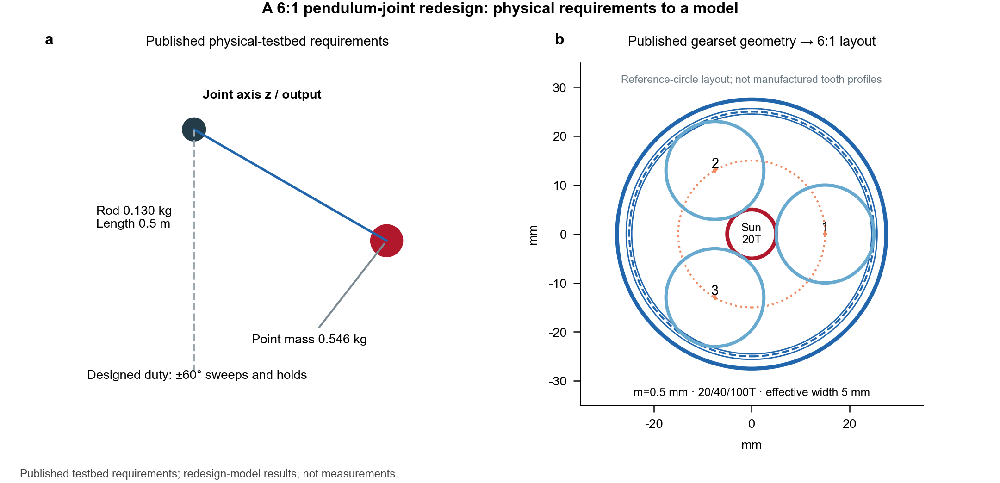
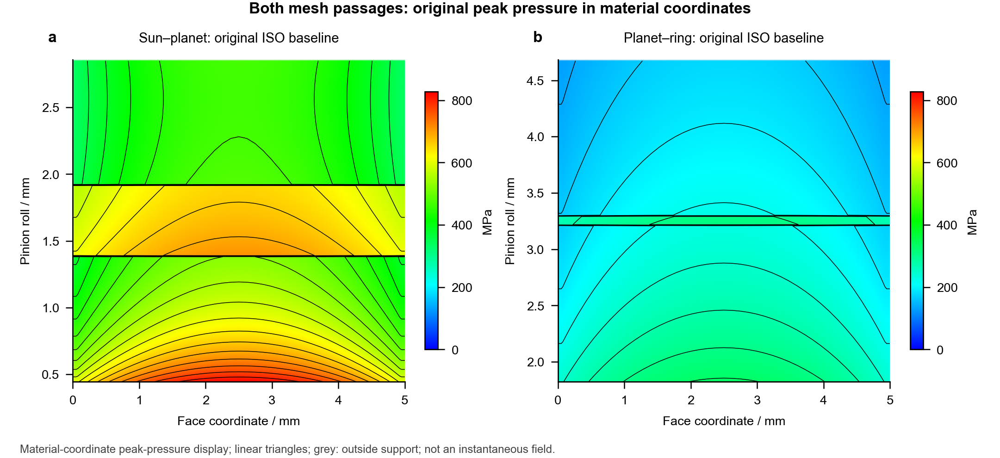
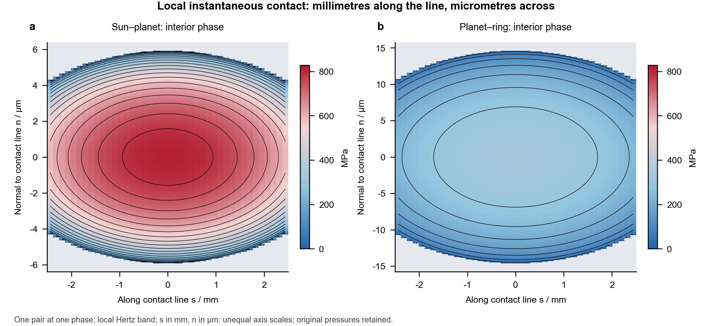
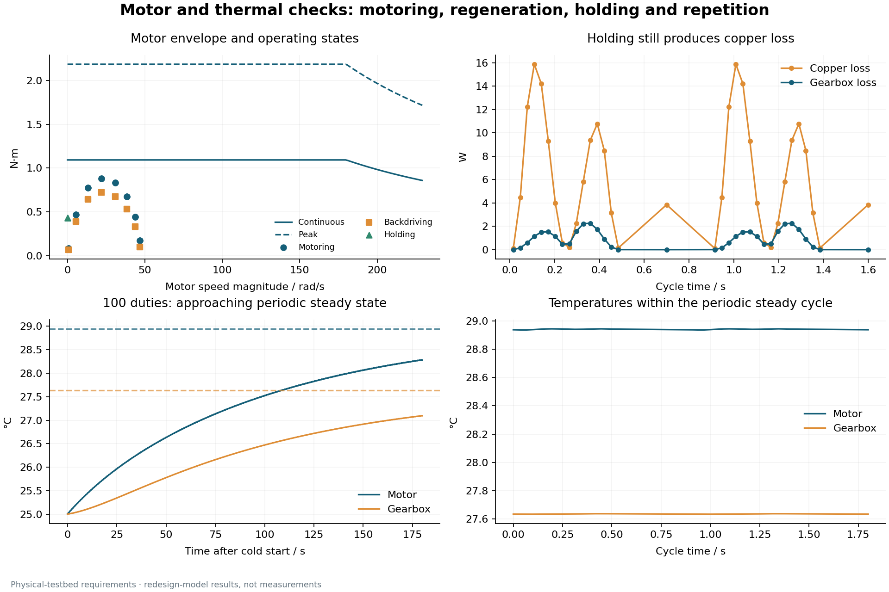
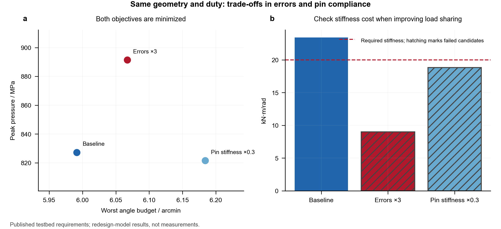
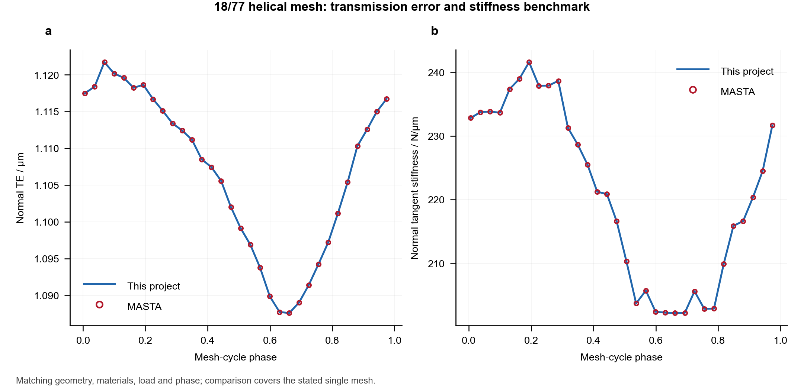

# Robot Joint Design

[中文](README.md) · [English](README.en.md)

[](https://www.python.org/) [](LICENSE) [](https://github.com/Lilililiyyy/robot-joint-design/tree/v0.6.0)

An independently developed robot joint design project for single-stage NGW planetary actuators. It connects task loads, gear contact, structural support, motor sizing, precision and thermal performance through parameterized calculations. Complete Python source, bilingual worked examples and engineering data exports support standalone use and integration into a design workflow.

## Contents

- [Design capabilities](#design-capabilities)
- [Installation and use](#installation-and-use)
- [Design example](#design-example)
- [Result benchmarks](#result-benchmarks)
- [Engineering scope](#engineering-scope)
- [Version history](#version-history)
- [Roadmap](#roadmap)
- [Documentation and structure](#documentation-and-structure)

## Design capabilities

|Module|Capabilities|
|---|---|
|Requirements and loads|Motion profiles, load inertia, gravity and acceleration torque, segmented duty histories|
|Planetary transmission|Assembly conditions, ratio, clearances, individual planet loads, path errors and compliance coupling|
|Gear contact|Internal/external LTCA, transmission error, tangent stiffness, local Hertz pressure, loaded flanks and full tooth-passage pressure maps|
|Strength and support|Explicit-factor flank/root rating, six-degree-of-freedom support, bearing reactions, pin geometry/material stiffness in sharing, pin bending/shear and basic planet-bearing rating|
|Motor and energy|Driving/backdriving efficiency, rotor inertia, torque–speed envelopes, RMS current, braking and regenerative-bus screening|
|Precision and thermal|Loaded angle, backlash/encoder budgets, segmented temperature response and periodic thermal equilibrium|
|Bench data|Bidirectional torque–angle calibration, fixture correction, held-out runs and model comparison|
|Life and selection|Rainflow cycles, cumulative damage with supplied S-N curves, constraint screening and finite-candidate Pareto comparison|
|Engineering outputs|Reports, JSON/CSV/NPZ, parameter-level CAD dimensions and BOM, bilingual publication-style PNG/SVG/PDF figures|

Modules share SI units and callable interfaces. See the [model](docs/model.en.md) and [API](docs/api.en.md) for equations and input/output definitions.

## Installation and use

For product-specific work, follow the [practical input/workflow guide](docs/practical_workflow.en.md). Standard reports now retain signed margins. [Finite scenario studies](docs/design_envelope.en.md) recalculate assembly/support changes and locate governing states, planets and meshes; missing required checks cannot count as a pass.

Python 3.10 or newer is required. From the repository root:

```bash
python -m pip install -e ".[plots]"
python -m robot_joint examples/dfki_pendulum_case.json --output output/pendulum
```

The source API can also be used directly:

```python
import json
from pathlib import Path
from robot_joint import analyze_joint, export_joint

config = json.loads(Path("examples/dfki_pendulum_case.json").read_text(encoding="utf-8"))
result = analyze_joint(config)
export_joint(result, "output/pendulum")
```

Length, angle, force, torque and pressure use m, rad, N, N·m and Pa. For calculation modules only, install with `python -m pip install -e .`.

## Design example

A 6:1 robot joint is designed around [published pendulum requirements](https://github.com/dfki-ric-underactuated-lab/torque_limited_simple_pendulum/blob/11a946d4e6db58d001fdeff89be269eb61461757/hardware/testbench_description.md), using tooth counts from a [published steel gearset](https://mjbots.com/products/m05-6x-planetary-gearset). Support, modifications, allowable stresses, thermal and electrical parameters are explicit project design inputs.



|Parameter|Value|
|---|---:|
|Point mass / rod and attachments / length|0.546 kg / 0.130 kg / 0.5 m|
|Sun / planet / ring|20 / 40 / 100 teeth|
|Module / planets / effective face width|0.5 mm / 3 / 5 mm|
|Ratio / model centre distance|6 / 15 mm|
|Motion task|±60°, 0.5 s move and 0.4 s hold, 1.8 s period|

**Load sharing and gear contact**

Thirty-four representative duty states connect three planets, both gear meshes and system compliance. Tooth-passage maps show local peak pressure experienced at material positions. Instantaneous bands use separate local coordinates along the contact line in mm and normal to it in μm. The two displays represent different quantities.





See [contact analysis](docs/contact_patterns.en.md) for positive/negative flanks, low-load states and individual member surfaces.

**Motor, thermal performance and design selection**

The same duty drives motor-envelope, current, braking and periodic-temperature calculations. Candidate comparisons show how path errors and pin compliance affect output stiffness, contact pressure and precision budgets.





An integrated candidate assumes a 6 mm planet pin, feeds its 297.707 MN/m bending/shear stiffness into the system, and includes planet bearings and a 4700 μF bus. Maximum pin load is about 118.889 N, minimum planet-bearing static safety about 4.206, and maximum bus voltage about 43.194 V. These results depend on the declared geometry, capacities, limits and electrical conditions.

Pin stiffness can remain a direct input or use explicit `pin_stiffness_source="pin_geometry"` to calculate stiffness from shared/per-pin geometry and material before the system solve. The [diameter comparison](examples/results/pin_stiffness_feedback/report.en.md) recalculates 6 mm, all-4 mm and first-pin-4 mm designs: resizing all pins reduces minimum output stiffness to 17643.769 N·m/rad, below this example's 20000 limit. Resizing one pin redistributes loads. Adopted stiffness, final reactions, mesh/pin/bearing results and convergence diagnostics are retained.

```bash
python -m robot_joint examples/dfki_pin_geometry.json --output output/pin_geometry
python -m examples.compare_pin_stiffness --output output/pin_comparison
```

The model remains a simply supported solid-pin bending/shear model with explicit boundary assumptions. Short-pin hole contact, fits and carrier-plate response require separate validation. See [planet support](docs/planet_support.en.md) for parameters and integration.

**Margins under assembly and support changes**

The [editable specification](examples/dfki_assembly_scenarios.json) varies path errors, sun radial stiffness, individual pin sizes and one combined point under the same duty and limits. Every scenario recalculates sharing and both meshes. See the [finite scenario report](examples/results/design_envelope/report.en.md). These sensitivity assumptions are neither manufacturing distributions nor failure probabilities or continuous-domain worst cases.

The nominal design passes, but selected assumed 1 μm path changes raise the maximum sharing factor to 2.775, and the combined scenario reduces minimum output stiffness to about 11146 N·m/rad. These violate the respective 2.0 upper and 20000 lower limits, directing attention to assembly/support requirements and governing states.

```bash
python -m examples.design_envelope --output output/design_envelope
```

The [worked example](docs/examples.en.md) explains module inputs, results and design tradeoffs. [Design criteria](docs/design_review.en.md) summarize requirements and engineering boundaries.

**Bidirectional torsion calibration**

Fit both loaded branches, then verify angle errors on separate runs. The synthetic example recovers the prescribed 18000/20000 N·m/rad stiffnesses and gives about 4 µrad maximum held-out error. Recalculate the nominal model at identical torques to inspect each branch's residuals. [CSV inputs, figures and reproduction](docs/torsion_calibration.en.md)

## Result benchmarks

An 18/77 helical mesh is compared with saved MASTA results for geometry, explicit-factor strength, transmission error, stiffness and contact pressure.

|Metric|MASTA|This project|
|---|---:|---:|
|Mean normal TE / μm|1.106704585|1.106704539|
|Mean normal tangent stiffness / N/μm|220.932698401|220.932698268|
|Peak endpoint pressure / MPa|186.674351800|186.674381661|
|Tooth-passage display peak / MPa|186.522329|186.524300|



On the same 30×30 display grid, pressure MAE is 0.040641 MPa, RMSE is 0.140090 MPa, and maximum absolute difference is 2.994763 MPa. The benchmark covers the stated single-mesh condition and does not establish measured joint-assembly performance. See [result benchmarks](docs/validation.en.md) for parameters and pressure maps.

## Engineering scope

The system models a fixed-ring, sun-input, carrier-output NGW stage with zero-shift spur gears, small deformation, linear elasticity and quasi-static cycle-averaged response. Additional stiffness, rating factors, allowable stresses, motor and thermal parameters are supplied inputs.

Outputs support design calculation and candidate selection. Manufacturing requires detailed housing/rim/carrier structures, fits and preload, tolerances, lubrication and oscillating-bearing design, followed by torsional, thermal and endurance validation. CAD/BOM outputs are currently parameter-level.

## Version history

- **0.6.0** adds bidirectional torsion calibration, held-out runs and same-load model comparison with editable CSV inputs and bilingual blue–red plots.
- **0.5.0**: Added signed margins, governing states/components and finite assembly/support scenario studies; missing required checks block acceptance; documented real-module inputs and workflow.
- **0.4.0**: Added an explicit pin geometry/material stiffness source, sharing and final mesh/pin/bearing checks, reproducible diameter comparisons and per-pin provenance; preserved direct stiffness inputs.
- **0.3.3**: Unified contact-pressure colour scale and figure style; added version badge, bilingual history and roadmap.
- **0.3.2**: Refined standalone documentation and focused public presentation on design capabilities and results.
- **0.3.1**: Completed tooth-passage and instantaneous contact maps and added a single-mesh pressure benchmark.
- **0.3.0**: Added planet-pin, planet-bearing and regenerative-bus checks to the integrated design workflow.
- **0.2.0**: Added design constraints, assessment coverage, strength benchmarks and bilingual publication-style figures.
- **0.1.2**: Added the complete bilingual example driven by published pendulum requirements.
- **0.1.0**: Established NGW transmission, support, motor, precision, fatigue, thermal and parameter-level engineering outputs.

## Roadmap

The following are planned directions rather than fully implemented capabilities.

|Direction|Planned work|
|---|---|
|Contact and modification|Parameterized modification search and multi-objective selection using pressure, TE and stiffness|
|Structure and assembly|Condensed rim, carrier and housing compliance; fits, preload and tolerance-chain analysis|
|Engineering calibration|Verify loaded stiffness and angular references with hardware data, then add efficiency and temperature identification|
|Drive and service|Finite-source, absorption and protection boundaries; actual oscillating-bearing duty assessment|
|Model extensions|Helical gears, multi-stage transmissions and broader system coupling after appropriate verification|

## Documentation and structure

- [Bidirectional static torsion calibration](docs/torsion_calibration.en.md)

- [Model and equations](docs/model.en.md) · [API and units](docs/api.en.md) · [Worked example](docs/examples.en.md)
- [Contact analysis](docs/contact_patterns.en.md) · [Planet support](docs/planet_support.en.md) · [Regenerative bus](docs/dc_bus.en.md)
- [Design criteria](docs/design_review.en.md) · [Result benchmarks](docs/validation.en.md) · [Figures](docs/figures.en.md)
- `robot_joint/`: joint system and performance modules; `gear_contact/`: gear geometry and contact modules.
- `examples/`: parameterized cases and design results; `benchmarks/`: benchmark inputs and results.

Licensed under [AGPL-3.0-only](LICENSE). See [license and dependencies](THIRD_PARTY_NOTICES.md).
