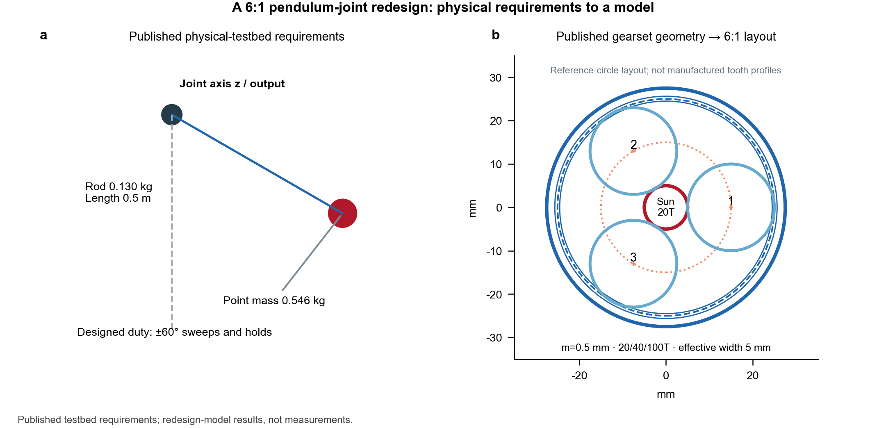
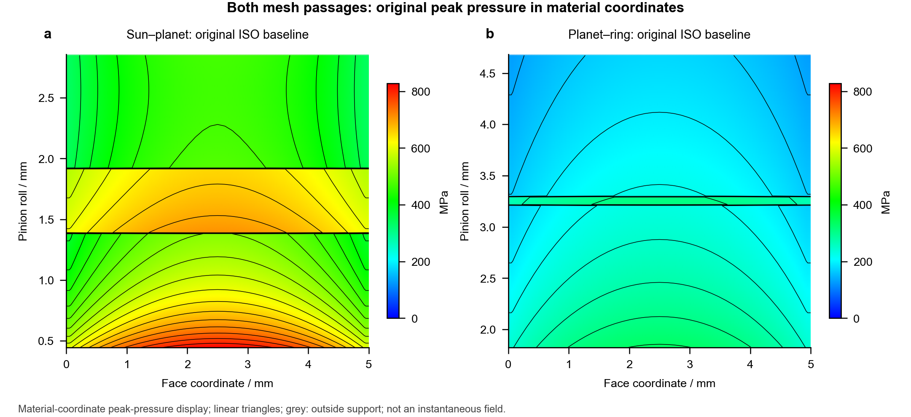
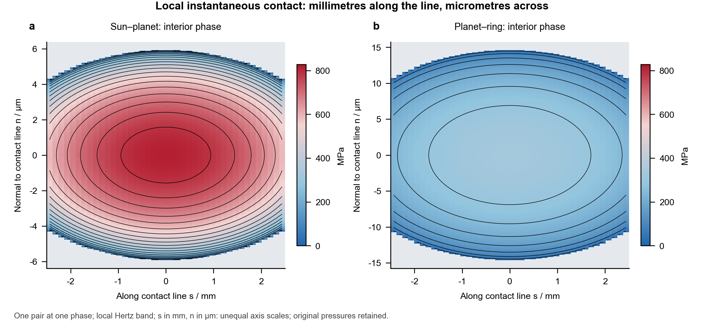
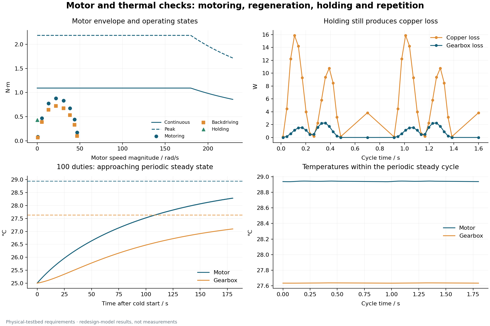
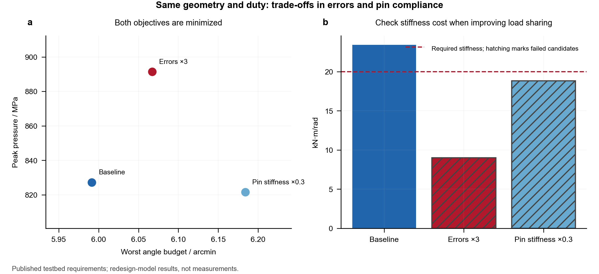
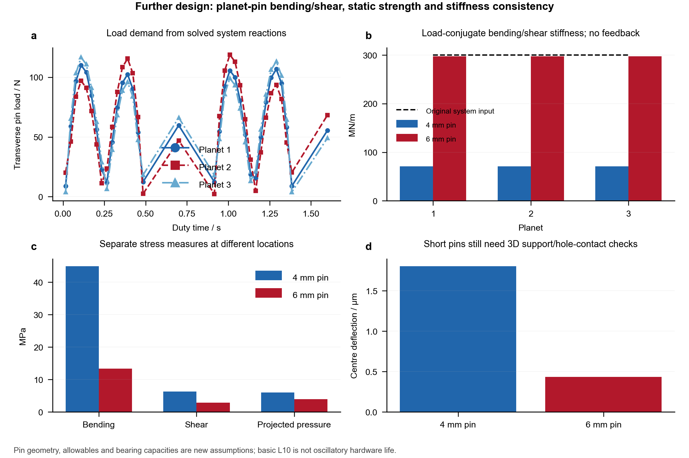
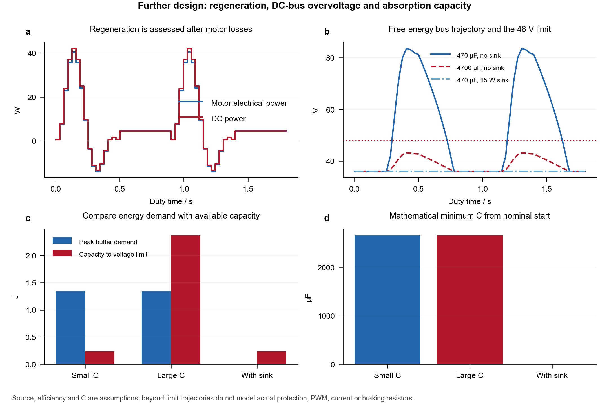
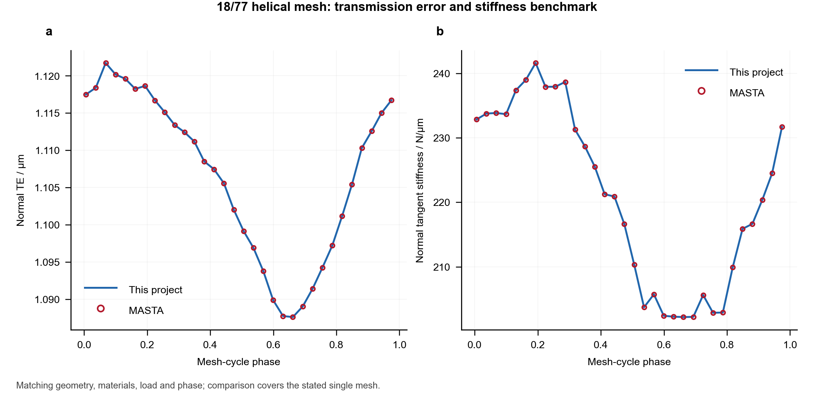
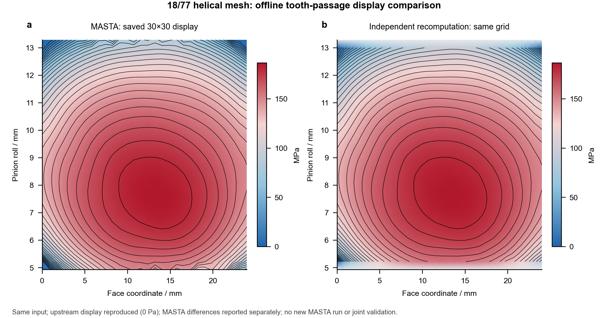

# Robot Joint Design

[中文](README.md) · [English](README.en.md)

[](https://www.python.org/) [](LICENSE)

An independent Python kernel for parameterized design and quasi-static assessment of a single-stage NGW robot joint. It connects duty loads, planetary sharing, per-planet LTCA, tooth-passage pressure displays, rating stresses, output support, motor matching, precision budgets and periodic temperature, with optional planet-pin/bearing and regenerative-bus screens.

## Contents

- [Installation and use](#installation-and-use)
- [Calculation capabilities](#calculation-capabilities)
- [Design review and improvements](#design-review-and-improvements)
- [Design case and candidate comparison](#design-case-and-candidate-comparison)
- [Professional-software and public-reference comparisons](#professional-software-and-public-reference-comparisons)
- [Verification and reproduction](#verification-and-reproduction)
- [Scope](#scope)
- [Release history and next steps](#release-history-and-next-steps)
- [Documentation and repository layout](#documentation-and-repository-layout)

## Installation and use

Requires Python 3.10 or later. Run from the project root:

```bash
python -m pip install -e ".[plots]"
python -m robot_joint examples/dfki_pendulum_case.json --output output/pendulum
```

For the calculation kernel alone, use `python -m pip install -e .`. The command entry point is `robot-joint`; functions can also be called directly:

```python
import json
from pathlib import Path
from robot_joint import analyze_joint, export_joint

config = json.loads(Path("examples/dfki_pendulum_case.json").read_text(encoding="utf-8"))
result = analyze_joint(config)
export_joint(result, "output/pendulum")
```

Interfaces use SI units: m, rad, N, N·m, Pa, s and K. Each state explicitly provides a six-component output wrench; axial moment `Mz` and required output torque share the same value and sign. See the [API contract](docs/api.en.md) for fields, coordinates and array layouts.

## Calculation capabilities

|Module|Implemented functions|Required inputs or boundary|
|---|---|---|
|NGW geometry and kinematics|Tooth assembly, adjacent-planet clearance, ratio, speeds and mesh-force relations|Fixed ring, sun input, carrier output; zero-shift spur gears|
|Planetary load sharing|Flank-specific path errors, pin compliance, shared sun translation and nonnegative path forces with unloading/re-entry|Supplied support stiffness and additional condensed compliance|
|Per-planet LTCA|Two-mesh cyclic TE, tangent stiffness, contact-node forces and local Hertz pressure; displacement-compatible iteration|Quasi-static, cycle-mean coupling; raw contact arrays retained|
|Contact pressure displays|Single-tooth instantaneous Hertz bands, full tooth-passage pressure/contours, three-planet and positive/negative-flank maps|Material-coordinate linear display interpolation from the cylindrical-LTCA project; separate local mm/μm snapshot axes; not a 2D contact or FE solve|
|Rating stresses|ISO 6336:2006 explicit-factor contact/bending stresses and safety factors|External rating factors and material limits supplied by the user|
|Structure and bearings|Six-DOF condensed stiffness, two-support reactions, revolution-weighted basic L10 and static safety|No actual bearing contact, preload, clearance or small-oscillation damage|
|Planet pins and bearings|Solid-pin bending/transverse shear/average hole pressure, bending–shear deflection/stiffness and individual basic bearing ratings|Explicit simple supports and load width; actual pin reactions and relative planet speed; dimensions, allowables and capacities must be supplied|
|Motor and brake|Motoring/backdriving efficiency, rotor inertia, torque–speed envelopes, RMS current and static brake screening|Supplied motor envelope, efficiencies, current convention and brake safety factor|
|Regenerative bus|Directional inverter efficiency, piecewise capacitor energy, overvoltage crossing times and buffering/absorption requirements|Ideal delivery source and explicit capacitance/sink limits; no actual protection, PWM or resistor thermal design|
|Precision and thermal response|Loaded angle, backlash, encoder and assembly budget; two-node transient/periodic temperature|Deterministic angular bound; thermal capacity/conductance and losses require calibration|
|Fatigue and candidate screening|Rainflow, supplied S–N, Goodman/Miner; explicit design limits and finite-candidate Pareto comparison|Applies to a supplied scalar hotspot history; does not infer whole-joint life|
|Engineering exports|JSON/CSV/NPZ, calculation report, CAD dimensions, parameter-level BOM and reference layout|No manufacturing solids, procurement part numbers or tolerance chain|

Rating stresses, local contact pressure, output angle budgets and controlled positioning accuracy have separate definitions. See the [model documentation](docs/model.en.md) for equations, coupling and omitted physics.

## Design review and improvements

Existing output-stiffness, load-sharing and supplied-hotspot damage limits report actual values, thresholds and coverage through `passed`, `failed`, `not_configured` and `not_evaluated`. Structural-reference offsets use work-conjugate transformations, and external gears retain the standard-rack undercut-risk screen. Version 0.3.0 adds pin-strength, planet-bearing and regenerative-bus screens; 0.3.1 corrects contact-map coordinates, quantity definitions and consistency with the source project's display. Optional modules use explicit inputs and criteria without silently replacing the original load-sharing stiffness.

The current case assumes `Kout≥20000 N·m/rad`, `Kγ≤2` and supplied-history `D≤1` for same-duty screening, not DFKI hardware specifications. Added dimensions, material allowables, bearing capacities and bus parameters are also recorded as design assumptions. The [design review](docs/design_review.en.md) separates implemented work from items that still require hardware or manufacturing data.

## Design case and candidate comparison

A 6:1 redesign uses [published DFKI physical-pendulum requirements](https://github.com/dfki-ric-underactuated-lab/torque_limited_simple_pendulum/blob/11a946d4e6db58d001fdeff89be269eb61461757/hardware/testbench_description.md), with geometry referenced to a [mjbots steel gearset](https://mjbots.com/products/m05-6x-planetary-gearset). It demonstrates the parameterized workflow; added support, modifications, thermal parameters and rating limits are recorded separately as assumptions.



|Parameter|Value|
|---|---:|
|Point mass / rod and mounts / length|0.546 kg / 0.130 kg / 0.5 m|
|Sun / planet / ring|20 / 40 / 100 teeth|
|Module / planet count / effective face width|0.5 mm / 3 / 5 mm|
|Ratio / pressure angle / shift|6 / 20° / zero|
|New motion duty|±60°; 0.5 s move, 0.4 s hold; 1.8 s period|

The supplier states a 30 mm center distance, while the listed zero-shift tooth counts and module give 15 mm. The model uses 15 mm and retains that source conflict for clarification. This is a source-grounded new design, without reconstruction of AK80-6 internals or measured-performance reproduction.

**Load sharing and full contact patterns**

Thirty-four representative states connect three planets, both meshes and system compliance, with baseline coupling at 64 phases ×26 strips. Selected fixed local loads are further resolved at 512 phases ×41 strips. The same display method as the [cylindrical-gear LTCA project](https://github.com/Lilililiyyy/cylindrical-gear-ltca) maps raw peak-pressure samples to face/material-roll coordinates and applies linear interpolation to display complete tooth-passage pressure and contours for both meshes.



Full-passage maps fold periodic results for identical teeth at fixed load into material coordinates. Coloured area is not the area loaded at one instant. Interpolation displays the original local peak pressures; it adds no 2D pressure or contact-boundary solve. Separate [positive-flank planets](examples/results/contact_patterns/en/02_positive_planets.png), [negative-flank planets](examples/results/contact_patterns/en/03_negative_planets.png), [low-load edges](examples/results/contact_patterns/en/04_low_load_planets.png) and [four member surfaces](examples/results/contact_patterns/en/05_members.png) retain state/member identity. See [contact-pattern documentation](docs/contact_patterns.en.md) for raw support points, display interpolation and model limits. The original [cyclic TE and contact-node plot](examples/results/dfki_pendulum/en/04_contact.png) shows the distinct cycle and node quantities.

Instantaneous contact uses local coordinates along the contact line, `s / mm`, and normal to that line, `n / μm`, so a micrometre-scale half-width remains visible. The axes have different display scales. Each map represents one tooth pair at one phase; its coloured area cannot be compared with passage-map area.



The default case retains the ISO spur model and zero profile crowning; single-/double-pair load switching can still produce zones in its passage map. A separate [explicit diagnostic](examples/results/contact_patterns/en/07_model_comparison.png) compares an ISO control baseline, Love only, and each member's profile crown replaced by 3 μm plus Love, resolving pressure, normal approach and stiffness. Control settings and changes from source input are recorded separately. This assumption is neither measured hardware geometry nor an optimization result. Version 0.3.0 mixed finite-Hertz-band envelopes with the source project's passage display; its “no interpolation” description did not apply to the latter. Those descriptions and figures are corrected; the default main workflow has not been altered to obtain an elliptical appearance.

**Motor matching and periodic temperature**

The same duty checks motoring/backdriving, motor envelopes and static brake requirements, then feeds segment losses into the two-node thermal model. Temperatures are conditional on the assumed thermal inputs.



**Candidate comparison under the same duty**

With geometry, materials and motion fixed, compare the baseline, increased path errors and flexible pins to expose trade-offs among pressure, angle budget and output stiffness.



The [complete case guide](docs/examples.en.md) contains all nine stages, input provenance and key numbers. Shared chart data are in [metrics.json](examples/results/dfki_pendulum/metrics.json) and [duty.csv](examples/results/dfki_pendulum/duty.csv); editable SVG/PDF files accompany the images. See the [figure guide](docs/figures.en.md) for the blue/red styling, source data, dimensions and English-only reproduction. CAD/BOM files provide parameter interfaces.

**Planet pins and bearings: check strength and stiffness separately**

Converged reactions give a maximum pin load of 118.889 N. Under the added 12 mm simply supported span and 5 mm loaded-width assumptions, 4/6 mm pins reach bending stresses of 44.939/13.315 MPa and centre deflections of 1.805/0.433 μm. Both pass the supplied static allowables. However, their load-conjugate bending–shear stiffnesses are only 71.225/297.707 MN/m against the system's assumed 300 MN/m. A 4 mm design requires an explicit stiffness update and a new load-sharing solve.



Planet bearings use speed relative to the carrier. With assumed capacities, minimum static safety is about 4.206; a large basic L10 does not establish oscillating service life. Short thick pins, actual pin-hole contact and catalog bearing selection still need independent design. Inputs, equations and [individual results](examples/results/planet_support/summary.json) are documented in [planet support](docs/planet_support.en.md).

**Regenerative bus: buffering capacity beyond power balance**

Using motor electrical power that includes copper loss and rotor-inertia power, compare new assumptions of a 36 V source, 48 V limit and 96% directional inverter efficiency. A 470 μF capacitor with no sink gives a free-energy extrapolated peak of 83.624 V and fails the limit; 4700 μF gives 43.194 V, while 470 μF with a 15 W external sink stays at 36 V.



DC regeneration peaks at 13.398 W and returns 2.678 J over the history. Without a sink, the nominal-start minimum capacitance is about 2656 μF. Beyond-limit voltages assume the specified power continues; real protection may disable the drive earlier. All bus values are design assumptions. See [the bus model](docs/dc_bus.en.md) and [comparison data](examples/results/dc_bus/comparison.csv).

**Integrated candidate with explicit geometry feedback**

The [new input](examples/dfki_with_screens.json) explicitly supplies the assumed 6 mm pin's 297.707 MN/m bending/shear stiffness to the system, then recouples all 34 states and includes planet-bearing static safety and a 4700 μF bus. This run was executed: stiffness discrepancy is zero, minimum planet-bearing static safety is about 4.206, and maximum bus voltage is 43.194 V; configured screening passes. The [Chinese calculation report](examples/results/integrated_design/report.md) and [summary JSON](examples/results/integrated_design/summary.json) retain actual criteria. Hardware undervoltage remains unevaluated; an ideal-source assumption is not hardware validation.

```bash
python -m robot_joint examples/dfki_with_screens.json --output output/integrated --plots
```

## Professional-software and public-reference comparisons

Evidence is reported at its actual calculation level:

|Evidence|Comparison target|Supported conclusion|
|---|---|---|
|Retained MASTA single-mesh reference|Cylindrical geometry, rating stresses and LTCA with matching input, flank, load and discretization|Numerical agreement of the reused contact kernel for the listed states|
|Public software references and independent equations|Declared algorithm tables, equilibrium relations and numerical solutions|Correctness and regression coverage of the corresponding module/equation|
|DFKI hardware and mjbots geometry documentation|Published masses, length, ratio, tooth counts and related parameters|Traceability of case inputs and geometric consistency|



The 18/77 helical pair is recalculated with matching inputs. All 12 geometry and 14 rating-stress common fields pass their declared tolerances. Cycle summaries are below; ppm expresses the relative difference in parts per million:

|Cycle metric|Saved MASTA reference|Current kernel|Relative difference / ppm|
|---|---:|---:|---:|
|Mean normal TE / μm|1.106704585|1.106704539|0.0414|
|TE peak-to-peak / μm|0.034133914|0.034133913|0.0400|
|Maximum endpoint contact pressure / MPa|186.674352|186.674382|0.160|
|Mean normal stiffness / N/μm|220.932698401|220.932698268|0.000603|

Endpoint pressure follows the reference endpoint definition and is saved separately from strip-centre peak pressure. In addition, all 48 scalar fields from two published MathWorks rainflow tables match; reproduction does not execute MATLAB.



The contact display is checked point by point on the original 18/77 case's 30×30 grid, including finite pressures and the unsupported-region mask, before application to NGW. The retained MASTA display and current recalculation share one blue/red scale. Raw endpoint pressure, interpolated pressure and upstream-display reproduction error are separate in the [reproduction summary](examples/results/contact_patterns/reference_reproduction.json). Agreement with the upstream display does not mean zero error against MASTA or validate the joint assembly.

See the [validation record](docs/validation.en.md) for reference inputs, retained results, absolute/relative differences and reproduction commands. Single-mesh comparisons do not cover the NGW assembly; hardware-parameter checks do not validate actual joint temperature, stiffness, precision or life.

## Verification and reproduction

```bash
python -m examples.build_showcase --output output/showcase --raw-output output/raw
python -m examples.build_contact_patterns --phases 512 --strips 41
python -m examples.compare_designs --output output/comparison.json
python -m examples.check_planet_support --results output/pendulum --output output/planet_support
python -m examples.check_dc_bus --results output/pendulum --output output/dc_bus
python -m examples.plot_design_screens
python -m examples.run_benchmarks --output output/benchmarks
python -m examples.check_joint_resolution --output output/benchmarks/resolution
python -m examples.plot_validation --source output/benchmarks --output output/benchmarks
python -m unittest discover -s tests -v
```

Tests cover planetary torque/path compatibility, reverse loading and unloading, six-DOF support, electromechanical power, rainflow, analytical thermal response and interface constraints. Contact displays separately check the source display grid, masks and local-coordinate quantity definitions. General regression tests cannot replace those checks or establish a pattern's physical accuracy. Results retain input, units and diagnostics. Convergence, vendor-component numerical comparisons and physical experiments are separate verification states. Passing configured design limits is a screening result for the chosen model and thresholds.

The resolution study compares seven actual solver grids at one peak-pressure state. It does not establish asymptotic convergence across all states or parameters. Figure exports include PNG and editable SVG/PDF. Add `--language en` to `build_showcase` and `plot_validation` for English-only figures; see the [figure guide](docs/figures.en.md).

## Scope

The system layer currently covers one fixed-ring, sun-input, carrier-output, zero-shift spur NGW stage with small deformation, linear elasticity and quasi-static cycle-mean response. The independent contact kernel supports additional single-mesh configurations, but the system interface has not been extended to helical, multistage, RV or harmonic drives.

Full housing/shaft FE, synchronized mesh dynamics, friction-history hysteresis, actual pin-hole/rolling-element contact, small-angle oscillatory wear, lubrication, electromagnetics, drive protection, control precision and tolerance chains remain outside scope. Pin/planet-bearing and bus screens have explicit simplified boundaries; finite-width bands are not a 2D contact solution. Light-load basic L10, assumed-hotspot damage and deterministic angle budgets are interpreted separately, without whole-joint life or positioning certification.

## Release history and next steps

- **0.1.0**: NGW system, support, fatigue, thermal, electromechanical, precision and parameter-level engineering exports.
- **0.1.2**: DFKI physical-requirement reference, complete bilingual case and figures, and a cross-platform floating-point tolerance fix for saved duty comparison.
- **0.2.0**: Project-level bilingual documentation, blue/red publication-style figures, expert design review, explicit assessment coverage and reproducible comparison evidence; a single default branch, `main`.
- **0.3.0**: Initial contact maps, planet-pin/bearing and regenerative-bus screens with bilingual data and documentation; the initial contact-display quantity/coordinate issues are corrected in 0.3.1.
- **0.3.1**: Passage displays aligned with the cylindrical-LTCA source project, local mm/μm instantaneous bands, matching 18/77 grid reproduction and a baseline/explicit-modification diagnostic; raw pressure, display interpolation and model changes are distinguished.
- **Near-term priorities**: Extend the resolution study to all critical duty states, add measured torsional stiffness/backlash and friction calibration, identify thermal networks and efficiency maps, and assess bearing suitability under actual oscillatory duty.
- **Later extensions**: Multistage/helical systems, physical gear-body/support compliance, manufacturing tolerance statistics and prototype comparisons after separate validation. These remain planned work.

## Documentation and repository layout

- [Model and equations](docs/model.en.md) · [API and units](docs/api.en.md) · [Complete case](docs/examples.en.md) · [Comparison evidence](docs/validation.en.md)
- [Design review and further validation](docs/design_review.en.md) · [Blue/red figures and source data](docs/figures.en.md)
- [Full contact patterns](docs/contact_patterns.en.md) · [Planet pins and bearings](docs/planet_support.en.md) · [Regenerative bus](docs/dc_bus.en.md)
- `robot_joint/`: new NGW system/performance modules; `gear_contact/`: reused cylindrical-contact kernel.
- `examples/`: inputs, runnable workflows and selected results; `benchmarks/`: offline references and comparison outputs.
- `tests/` and `.github/`: automated verification; `docs/`: equations, integration and engineering guidance.

The project uses [AGPL-3.0-only](LICENSE). See the [source and license notices](THIRD_PARTY_NOTICES.md) for reused code, source commits and dependencies.
