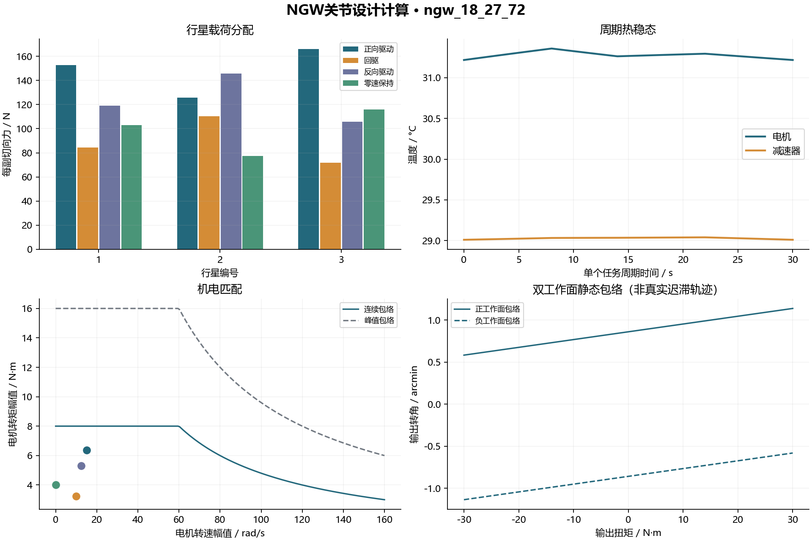
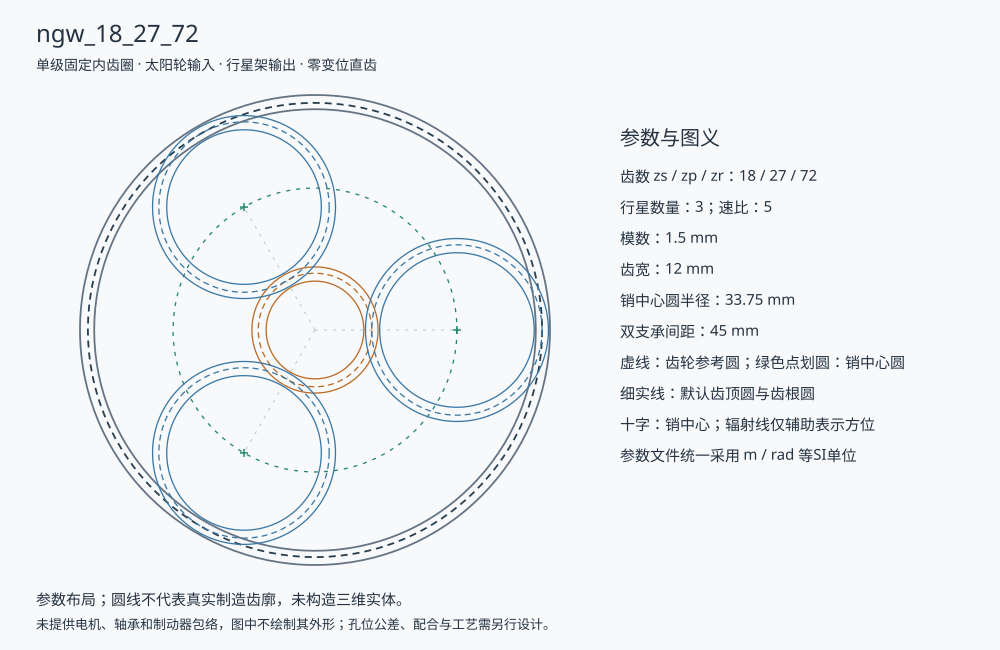

# Robot Joint Design

单级NGW机器人关节模组的参数化设计与准静态校核计算内核。输入几何、载荷、材料、修形、支承和电机参数，计算行星载荷分配、两副齿轮接触、强度、输出角度预算、支承寿命、机电匹配与温升，并导出原始接触数组、中文报告及CAD/BOM参数。

当前版本 **0.1.0**，适用于固定内齿圈、太阳轮输入、行星架输出的**零变位直齿单级NGW**。代码为新写的降阶工程实现，复用公开圆柱齿轮内核；运行时不需要厂商DLL或商业软件。



## 安装与复算

建议Python 3.10及以上，依赖NumPy、SciPy；绘图另需Matplotlib。

```bash
python -m pip install ".[plots]"
python -m robot_joint examples/ngw_18_27_72.json --output output/ngw --plots
python -m unittest discover -s tests -v
```

也可复制`robot_joint/`和`gear_contact/`两个源码目录到自己的软件中直接调用，保留许可证文件：

```python
import json
from pathlib import Path
from robot_joint import analyze_joint, export_joint

config = json.loads(Path("examples/ngw_18_27_72.json").read_text(encoding="utf-8"))
result = analyze_joint(config)
print(result.summary)
export_joint(result, "output/ngw", plots=True)
```

命令行入口`robot-joint`与`python -m robot_joint`等价。所有输入采用SI：m、rad、N、N·m、Pa、s、K；刚度须区分N/m与N·m/rad。

## 计算范围

|模块|当前实现|重要输入与边界|
|---|---|---|
|几何与运动学|齿数关系、均布装配、邻接间隙、Willis转速|零变位直齿，不生成刀具过渡和制造齿廓|
|行星载荷分配|单边路径接触、销柔度、太阳轮共享平移、附加凝聚柔度|正反工作面的误差、支承刚度或柔度必须显式输入|
|齿面与系统协调|逐行星两副LTCA、周期平均位移、切线/截距反馈|给定结构与失准传递模型；不求同步相位整机动力学|
|标准应力组合|ISO 6336:2006显式因子接触/齿根应力与安全系数|评级因子和材料限值来自外部，不自动计算全部标准因子|
|支承与轴承|6自由度小位移、双支承反力、变载基本L10及静安全|给定凝聚刚度和目录系数；不含轴承内部预紧/游隙求解|
|精度|串联结构柔度、自由侧隙、编码器半计数和确定性误差预算|未补偿的上界；双工作面静态包络不是实际迟滞|
|疲劳|雨流、显式S-N、可选Goodman、Miner|使用给定热点标量应力历程，不代表完整齿轮/整机寿命|
|机电|驱动/回驱、保持铜耗、转子惯量、包络/RMS与静态制动|效率和电机参数由调用者给定；未仿真驱动控制|
|热|双节点精确瞬态、段内峰温及周期热稳态|输入热容、热导及损耗；无空间温度场或参数温度反馈|
|设计交付|多候选重算与Pareto比较、原数组、CAD参数、BOM及布局|参数级工程接口，不输出制造实体或采购型号|

详细公式、坐标和约束见[模型说明](docs/model.md)，字段与接入方法见[接口说明](docs/api.md)。

## 当前案例

[示例输入](examples/ngw_18_27_72.json)采用太阳轮/行星轮/内齿圈18/27/72、3颗行星、模数1.5 mm、齿宽12 mm，速比5。30秒代表任务含正向驱动、回驱、反向驱动和零速保持，峰值输出扭矩30 N·m。

|示例指标|计算结果|
|---|---:|
|最大行星均载系数|1.2420|
|最大局部Hertz压力|742.893 MPa|
|最小输出扭转刚度|371624 N·m/rad|
|最大确定性输出角度预算|0.000453907 rad|
|重复任务周期稳态电机峰温|31.3582 °C|
|重复任务周期稳态减速器峰温|29.0402 °C|

以上材料、评级因子、支承、效率和热参数是**未经具体产品标定的示例输入**。结果用于复算和方案方法展示，不构成产品性能声明。轴承基本寿命在轻载下可能极大，不能将它直接解释为机器人摆动轴承的实物服役寿命。

计算输出包括`report.md`、`summary.json`、`planets.csv`、`motor.json`、`thermal.json`、`bearings.json`、`fatigue.json`，各工况各行星两副啮合的`arrays.npz`及诊断，以及`cad_parameters.json`、`bom.csv`、`layout.svg`。NPZ保留原接触节点、活动掩码、载荷、压力与刚度，使用`allow_pickle=False`读取。



多方案比较使用[可编辑脚本](examples/compare_designs.py)：

```bash
python -m examples.compare_designs --output output/comparison.json
```

候选比较只覆盖输入集合；更改几何后应重新提供依赖几何的评级因子。当前示例比较原误差、放大路径误差与较软行星销，所用几何不变。

## 验证与限制

测试覆盖解析均载、虚功、力/矩/功率平衡、路径脱开与重入、正反受载、极低载与零载、切线/截距协调、支承反力、公开雨流参考表、轴承基本寿命、热能量及周期边界、机电包络和导出复算。新写系统层尚未完成商业软件总成对标或实物试验验证。复用的齿轮模块具有自身的有限范围数值对标基础，见其公开来源；不能把单副一致性推广成整关节精度认证。

首版未实现多级/斜齿/变位NGW、RV、谐波柔轮、完整FE装配、实测摩擦迟滞、小角摆动轴承修正、控制器、电磁设计和样机认证。输入中的未实现分支或未知字段明确报错。后续优先扩展完整轴/行星架结构模型、实测支承与摩擦数据、多级接口及样机回标。

许可证为[AGPL-3.0-only](LICENSE)。公开齿轮模块的来源和原字节快照说明见[第三方及复用说明](THIRD_PARTY_NOTICES.md)。
