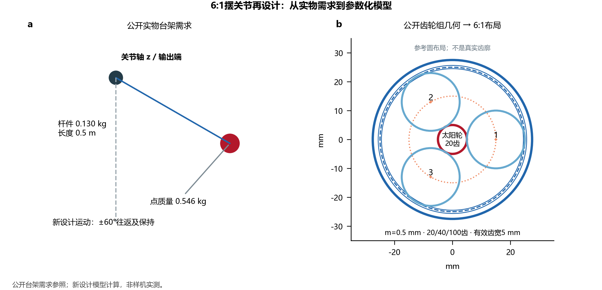
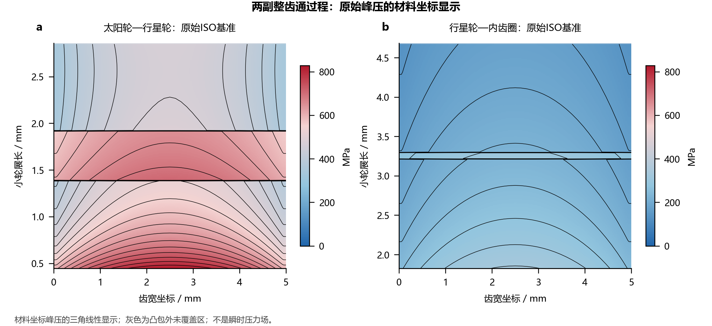
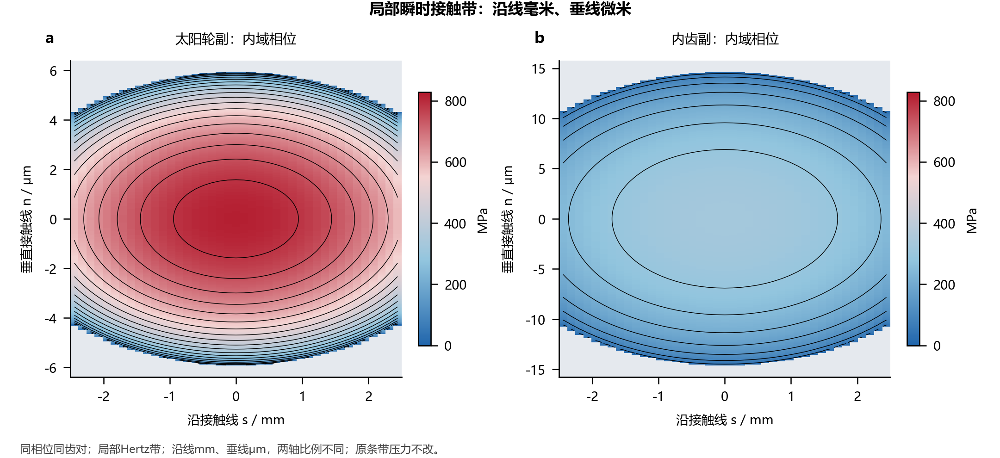
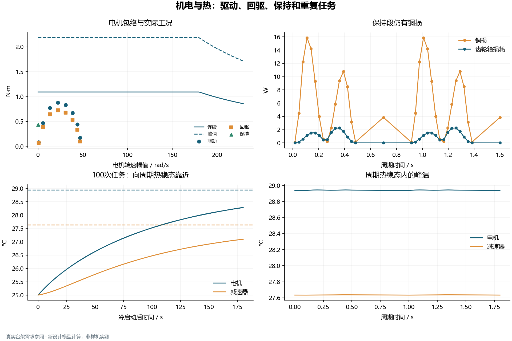
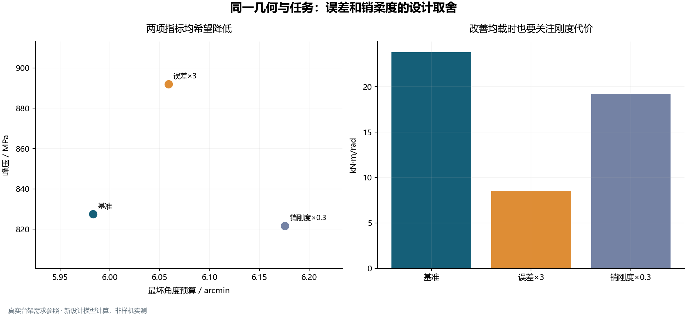
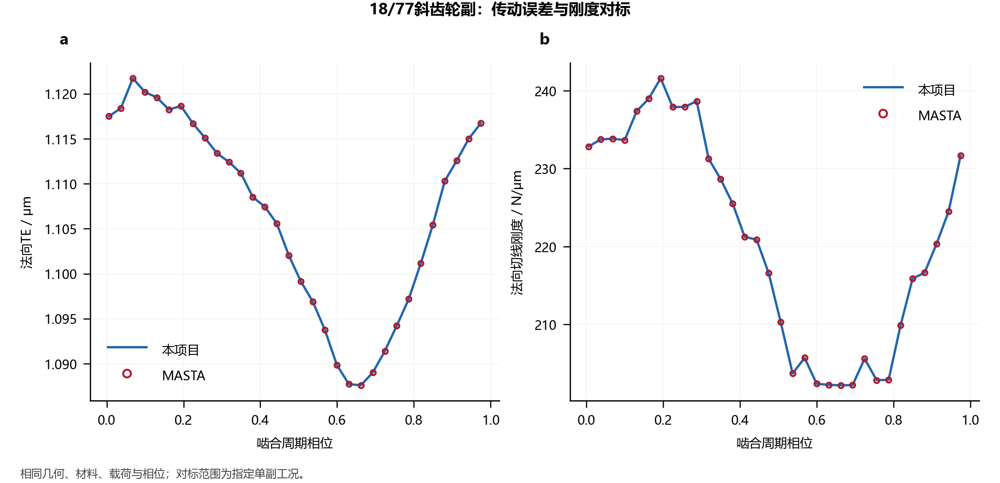

# Robot Joint Design

[中文](README.md) · [English](README.en.md)

[](https://www.python.org/) [](LICENSE) [](https://github.com/Lilililiyyy/robot-joint-design/tree/v0.6.0)

自主开发的机器人关节模组设计项目，面向单级NGW行星传动关节，提供从任务载荷到齿轮接触、支承结构、机电匹配、精度和热性能的参数化计算。项目包含完整Python源码、双语图文案例与工程数据导出，可独立运行和接入设计流程。

## 目录

- [设计能力](#设计能力)
- [安装与使用](#安装与使用)
- [设计案例](#设计案例)
- [结果对标](#结果对标)
- [工程范围](#工程范围)
- [版本更新记录](#版本更新记录)
- [后续计划](#后续计划)
- [文档与项目结构](#文档与项目结构)

## 设计能力

|模块|功能|
|---|---|
|需求与载荷|运动轨迹、负载惯量、重力及加速转矩、分段任务载荷谱|
|行星传动|齿数装配、速比、空间间隙、逐行星载荷分配、路径误差与柔度协调|
|齿轮接触|内外两副LTCA、传动误差、切线刚度、局部Hertz压力、正反工作面和完整齿通过程压力图|
|强度与支承|显式因子齿面/齿根评级、六自由度支承、轴承反力、销几何/材料刚度参与分载、销弯剪与行星轴承基本评级|
|机电与能量|驱动/回驱效率、转子惯量、电机转矩—转速包络、RMS电流、制动与再生母线初筛|
|精度与热|承载角、侧隙和编码器误差预算、分段温升与周期热稳态|
|台架数据|双向扭矩—角度标定、夹具柔度修正、独立试次留验及同扭矩点模型对照|
|寿命与选型|雨流循环、给定S-N曲线的累积损伤、约束筛选与有限候选Pareto比较|
|设计裕量|约束余量与危险工况定位、有限装配/销参数/支承变化情景、必需校核缺失拦截|
|工程输出|计算报告、JSON/CSV/NPZ、参数级CAD尺寸与BOM、论文风格的中英PNG/SVG/PDF图表|

各模块通过统一的SI单位和函数接口连接。计算方法见[模型说明](docs/model.md)，输入、输出和接口见[API文档](docs/api.md)。

用于实际模组时，先按[真实设计使用流程](docs/practical_workflow.md)准备任务、材料、采购件、结构与验收输入。普通计算报告显示有符号约束裕量；[有限情景校核](docs/design_envelope.md)进一步重算装配和支承变化，并定位超限或裕量最小的任务段、行星与齿轮副。未评价或未配置的必需项不会视为通过。

## 安装与使用

需要Python 3.10或更新版本，在项目根目录执行：

```bash
python -m pip install -e ".[plots]"
python -m robot_joint examples/dfki_pendulum_case.json --output output/pendulum
```

也可直接调用源码接口：

```python
import json
from pathlib import Path
from robot_joint import analyze_joint, export_joint

config = json.loads(Path("examples/dfki_pendulum_case.json").read_text(encoding="utf-8"))
result = analyze_joint(config)
export_joint(result, "output/pendulum")
```

长度、角度、力、转矩、压力分别采用m、rad、N、N·m、Pa。仅使用计算模块时可安装`python -m pip install -e .`。

## 设计案例

以[公开摆台需求](https://github.com/dfki-ric-underactuated-lab/torque_limited_simple_pendulum/blob/11a946d4e6db58d001fdeff89be269eb61461757/hardware/testbench_description.md)为基础，开展6:1机器人关节再设计，齿数组合参考[公开钢齿轮组](https://mjbots.com/products/m05-6x-planetary-gearset)。支承、修形、材料限值、热参数及电气参数作为本项目的明确设计输入。



|参数|取值|
|---|---:|
|摆端质量 / 杆与连接件质量 / 摆长|0.546 kg / 0.130 kg / 0.5 m|
|太阳轮 / 行星轮 / 内齿圈|20 / 40 / 100齿|
|模数 / 行星数 / 有效齿宽|0.5 mm / 3 / 5 mm|
|速比 / 模型中心距|6 / 15 mm|
|运动任务|±60°，移动0.5 s、保持0.4 s，周期1.8 s|

**载荷分配与齿轮接触**

34个代表工况连接三颗行星、两副齿轮与系统柔度。完整齿通过程图表示材料位置经历的局部峰压；瞬时接触带单独使用沿线mm、垂线μm坐标。两类图对应不同的物理量。





正反工作面、低载和各构件齿面结果见[接触分析](docs/contact_patterns.md)。

**机电、温升与方案选择**

同一任务载荷用于电机包络、电流、制动及周期温升计算，再比较路径误差和销柔度对输出刚度、接触压力与精度预算的影响。





集成方案采用假定6 mm行星销，将弯剪刚度297.707 MN/m反馈至系统，并加入行星轴承及4700 μF母线：最大销载约118.889 N，最小行星轴承静安全约4.206，最高母线电压约43.194 V。以上结果取决于案例中明确给定的几何、容量、限值与电气条件。

销刚度可继续直接输入，也可显式选择`pin_stiffness_source="pin_geometry"`，由共享或逐销几何与材料参数计算后参与系统求解。[尺寸比较](examples/results/pin_stiffness_feedback/report.md)重新计算6 mm、全部4 mm及仅第一销4 mm方案：全部减径使最小输出刚度降至17643.769 N·m/rad，未满足本例20000下限；单销减径使载荷重新分配。各方案保存实际采用刚度、最终反力、齿面/销/轴承结果及收敛诊断。

```bash
python -m robot_joint examples/dfki_pin_geometry.json --output output/pin_geometry
python -m examples.compare_pin_stiffness --output output/pin_comparison
```

销模型仍是明确边界下的简支圆销弯剪模型；短粗销的销孔、配合和架板三维响应需要单独验证。参数、公式与接入方法见[行星支承](docs/planet_support.md)。

**装配与支承变化下的设计裕量**

[可编辑情景](examples/dfki_assembly_scenarios.json)在相同任务及验收限值下，分别改变路径误差、太阳支承刚度、逐销尺寸及其组合，逐个重算分载和两副齿面。结果见[有限情景报告](examples/results/design_envelope/report.md)。情景为明确的敏感性假设，不代表制造分布、失效概率或连续公差域的最坏点。

名义方案通过，但本例假定的部分路径1 μm变化使最大均载系数达到2.775，组合情景最小输出刚度约11146 N·m/rad，分别超过2.0上限、低于20000下限。这些差异提示装配/支承要求应结合危险工况校核，不能只看名义参数。

```bash
python -m examples.design_envelope --output output/design_envelope
```

[完整图文案例](docs/examples.md)介绍各模块的输入、结果及设计取舍；[设计准则](docs/design_review.md)汇总判定要求和工程边界。

**双向扭转标定**

导入两批台架试次，分别拟合正反向承载刚度，再用独立试次核对角误差。合成示例恢复了 18000/20000 N·m/rad 的预设刚度，留验最大误差约 4 µrad。用相同扭矩点复算名义设计，可查看各侧模型偏差。[CSV 接入、双语图及复算方法](docs/torsion_calibration.md)

## 结果对标

采用18/77斜齿轮副与已保存的MASTA参考结果进行单副对标，比较几何、显式因子强度、传动误差、刚度及接触压力。

|指标|MASTA|本项目|
|---|---:|---:|
|平均法向TE / μm|1.106704585|1.106704539|
|平均法向切线刚度 / N/μm|220.932698401|220.932698268|
|最大端点压力 / MPa|186.674351800|186.674381661|
|通过程显示峰压 / MPa|186.522329|186.524300|



同一30×30显示网格上的接触压力MAE为0.040641 MPa、RMSE为0.140090 MPa，最大绝对差为2.994763 MPa。对标范围为所列单副工况，尚不代表关节总成的实测性能。案例参数、压力图与结果说明见[结果对标](docs/validation.md)。

## 工程范围

当前系统面向固定内齿圈、太阳轮输入、行星架输出的零变位直齿NGW，采用小变形、线弹性和准静态周期平均模型。额外刚度、评级因子、许用值、电机和热参数需由设计输入提供。

输出用于设计计算和方案筛选。实际制造仍需完成箱体/轮缘/行星架结构、配合与预紧、公差、润滑及摆动轴承设计，并开展扭转、温升和耐久验证。当前CAD/BOM为参数级工程输出。

## 版本更新记录

- **0.6.0** 增加双向扭转标定、独立试次留验及同载荷模型对照。提供可编辑 CSV 和蓝红色双语复算图。
- **0.5.0**：增加约束裕量、危险工况/构件定位及有限装配/支承情景复算；必需校核缺失时阻止情景通过，补充真实模组输入与实施流程。
- **0.4.0**：增加销几何/材料刚度的显式来源选项，接入分载与最终齿面、销、轴承校核；新增可复算尺寸比较及逐销来源记录，兼容原显式刚度路径。
- **0.3.3**：统一接触压力色阶与图表样式，补充版本徽章、双语更新记录和后续计划。
- **0.3.2**：完善独立项目说明，精简公开展示，集中呈现设计功能与正式结果。
- **0.3.1**：完善整齿通过程与瞬时接触图，增加单副接触压力结果对标。
- **0.3.0**：加入行星销、行星轴承及再生母线校核，并接入集成设计流程。
- **0.2.0**：增加设计约束、校核覆盖、标准强度对标和论文式双语图表。
- **0.1.2**：加入公开摆台需求驱动的完整中英设计案例。
- **0.1.0**：建立NGW传动、支承、机电、精度、疲劳、热及参数级工程输出。

## 后续计划

以下为规划方向，尚未全部实现。

|方向|计划内容|
|---|---|
|接触与修形|增加参数化修形搜索，结合压力、TE与刚度开展多目标方案筛选|
|结构与装配|接入轮缘、行星架及箱体凝聚柔度，完善配合、预紧与公差链分析|
|工程标定|用样机双向扭转数据验证承载刚度及角度基准，增加效率与温升数据接入和参数识别|
|采购与公差|接入实际轴承和材料数据；由尺寸链/结构模型映射装配误差，逐步扩展公差域校核|
|驱动与服役|完善有限电源、吸收支路及保护边界，补充实际摆动轴承的服役评价|
|模型扩展|在相应校核完成后扩展斜齿、多级传动与更完整的系统耦合|

## 文档与项目结构

- [模型与公式](docs/model.md) · [API与单位](docs/api.md) · [图文案例](docs/examples.md)
- [真实设计使用流程](docs/practical_workflow.md) · [设计裕量与有限情景](docs/design_envelope.md)
- [双向静态扭转标定](docs/torsion_calibration.md)
- [接触分析](docs/contact_patterns.md) · [行星支承](docs/planet_support.md) · [再生母线](docs/dc_bus.md)
- [设计准则](docs/design_review.md) · [结果对标](docs/validation.md) · [图表说明](docs/figures.md)
- `robot_joint/`：关节系统与性能模块；`gear_contact/`：齿轮几何与接触模块。
- `examples/`：参数化案例与正式设计结果；`benchmarks/`：对标输入和结果。

项目采用[AGPL-3.0-only](LICENSE)，依赖说明见[许可证与依赖](THIRD_PARTY_NOTICES.md)。
