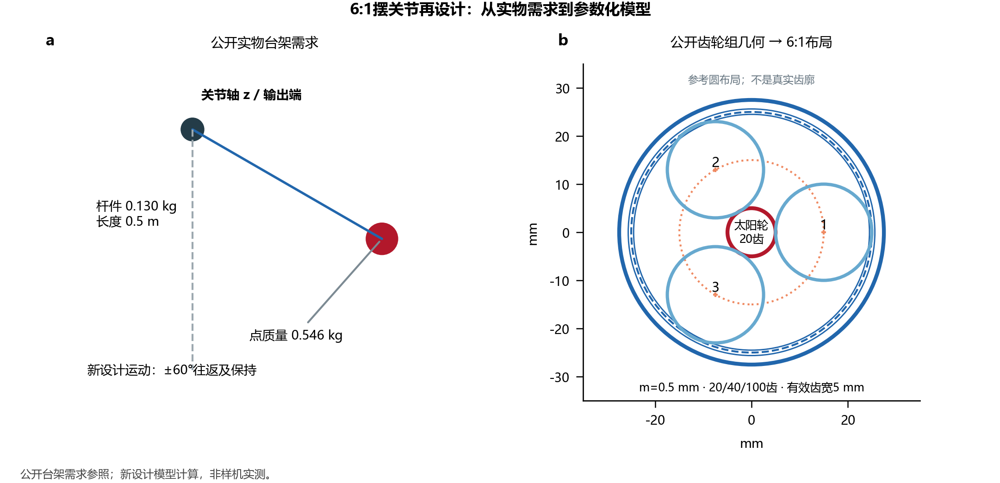
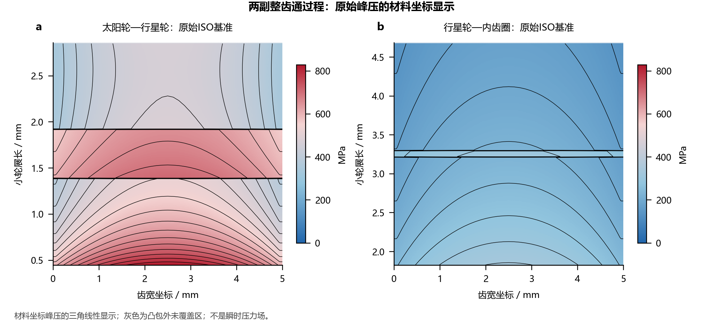
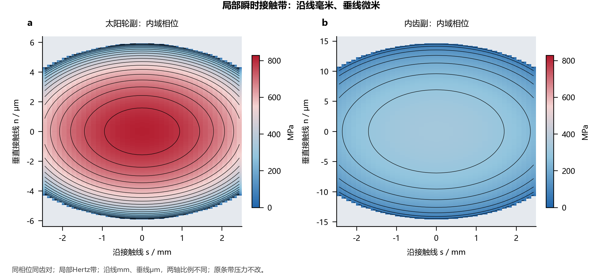
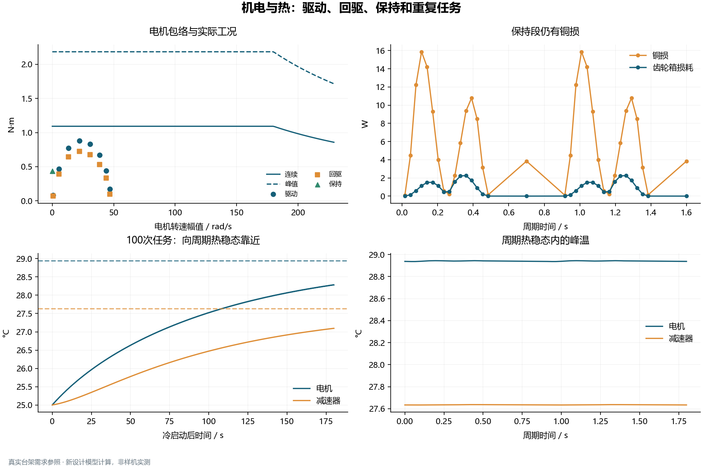
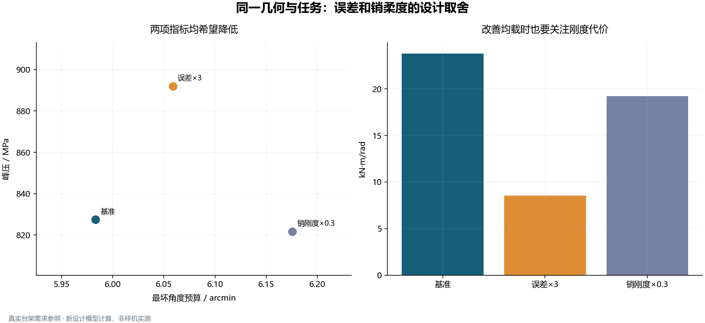
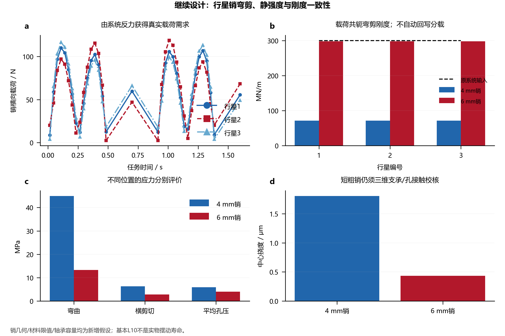
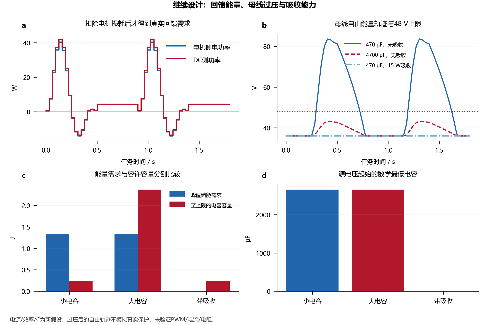
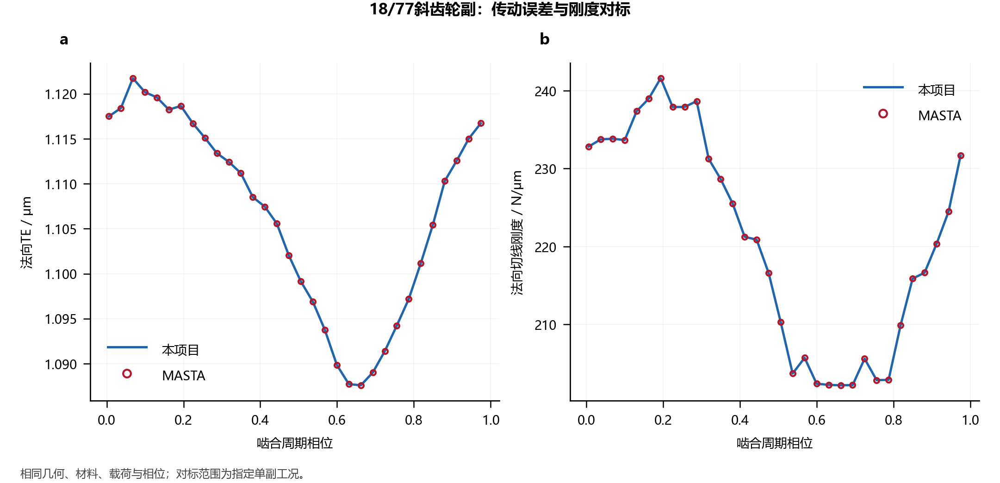
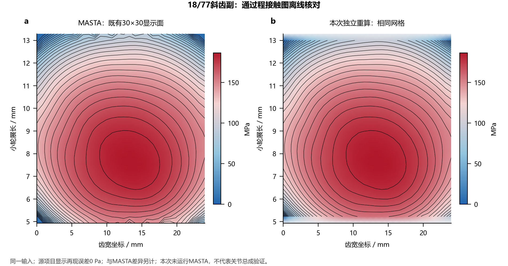

# Robot Joint Design

[中文](README.md) · [English](README.en.md)

[](https://www.python.org/) [](LICENSE)

NGW机器人关节模组设计与准静态校核计算。连接载荷谱、行星均载、逐行星LTCA、齿通过程压力显示、标准强度、输出支承、机电匹配、精度预算与周期热响应，并提供可选的行星销/行星轴承及再生母线初筛。
## 目录

- [安装与调用](#安装与调用)
- [计算能力](#计算能力)
- [设计审查与修订](#设计审查与修订)
- [设计案例与方案比较](#设计案例与方案比较)
- [专业软件与公开参考对标](#专业软件与公开参考对标)
- [验证与复算](#验证与复算)
- [适用范围](#适用范围)
- [更新记录与后续计划](#更新记录与后续计划)
- [文档与文件组织](#文档与文件组织)

## 安装与调用

需要 Python 3.10 或更新版本。在项目根目录执行：

```bash
python -m pip install -e ".[plots]"
python -m robot_joint examples/dfki_pendulum_case.json --output output/pendulum
```

仅使用计算内核时，执行 `python -m pip install -e .`。命令入口为 `robot-joint`，也可直接调用函数：

```python
import json
from pathlib import Path
from robot_joint import analyze_joint, export_joint

config = json.loads(Path("examples/dfki_pendulum_case.json").read_text(encoding="utf-8"))
result = analyze_joint(config)
export_joint(result, "output/pendulum")
```

接口采用SI单位：长度 m、角度 rad、力 N、扭矩 N·m、压力 Pa、时间 s、温度 K。每个工况显式提供输出端六分量载荷；轴向力矩 `Mz` 与输出扭矩保持同值、同符号。字段、坐标和数组布局见[接口说明](docs/api.md)。

## 计算能力

|模块|已实现功能|主要输入或边界|
|---|---|---|
|NGW几何与运动学|齿数装配、相邻行星间隙、速比、转速与啮合载荷关系|固定内齿圈、太阳输入、行星架输出；零变位直齿|
|行星载荷分配|双工作面路径误差、销柔度、太阳轮共享平移、非负路径力与脱开/重入|支承刚度及额外凝聚柔度由输入给定|
|逐行星LTCA|内外两副周期TE、切线刚度、接触节点力与局部Hertz压力；位移协调迭代|准静态、周期平均耦合；保留原始接触数组|
|接触压力显示|单齿瞬时Hertz带、完整齿通过程压力与等压线、三行星及正反工作面图|沿用圆柱齿轮LTCA项目的材料坐标线性插值显示；瞬时带另用局部mm/μm坐标，非二维接触或FE|
|标准强度|ISO 6336:2006显式因子接触/齿根应力及安全系数|外部评级因子、材料限值由用户提供|
|结构与轴承|六自由度凝聚刚度、双支承反力、转数加权基本L10与静安全|不含实际轴承接触、预紧、游隙和小角摆动损伤|
|行星销与行星轴承|圆实销弯曲/横剪/平均孔压、弯剪挠度与刚度、逐行星基本评级|显式简支与加载宽度；使用真实销反力和行星相对转速，尺寸/许用值/容量须给定|
|机电与制动|驱动/回驱效率、转子惯量、转矩—转速包络、RMS电流、静态制动初筛|电机包络、效率、电流基准与制动安全系数由输入给定|
|再生母线|双向逆变效率、分段电容储能、过压阈值时刻及缓冲/吸收需求|理想供能源、显式电容与吸收上限；不模拟实际保护、PWM或电阻热设计|
|精度与热|承载角、侧隙、编码器及装配误差预算；双节点瞬态/周期热稳态|确定性角度上界；热容、热导及损耗参数需标定|
|疲劳与方案筛选|雨流、给定S-N、Goodman/Miner；显式设计限值与有限候选Pareto比较|对给定标量热点应力谱有效，不自动预测整机寿命|
|工程交付|JSON/CSV/NPZ、计算报告、CAD尺寸参数、参数级BOM与参考布局|未生成制造实体、采购型号或公差链|

标准评级应力、局部接触压力、输出角度预算和控制定位精度分别定义。模型公式、耦合关系和未覆盖物理见[模型说明](docs/model.md)。

## 设计审查与修订

已有最小输出刚度、最大均载系数与给定热点谱损伤限值，以 `passed`、`failed`、`not_configured`、`not_evaluated` 四种状态报告实际值、阈值和覆盖范围。结构参考点偏置采用保持虚功的变换，外齿轮保留标准齿条假设下的根切风险提示。0.3.0增加销强度、行星轴承与再生母线初筛；0.3.1针对接触图的坐标、量定义和源项目显示一致性进行纠正。可选模块使用明确输入和判据，不暗中回写原分载刚度。

当前案例假定 `Kout≥20000 N·m/rad`、`Kγ≤2`、给定谱 `D≤1`，用于同任务方案筛选，不是DFKI公布的实物指标。新增零件尺寸、材料许用值、轴承容量及母线参数同样单列为设计假设。已落实与仍需实物/制造数据的工作见[设计审查](docs/design_review.md)。

## 设计案例与方案比较

以[DFKI公开实物摆台需求](https://github.com/dfki-ric-underactuated-lab/torque_limited_simple_pendulum/blob/11a946d4e6db58d001fdeff89be269eb61461757/hardware/testbench_description.md)构建6:1关节再设计，几何参照[mjbots钢齿轮组](https://mjbots.com/products/m05-6x-planetary-gearset)。案例用于展示参数化设计流程；新增支承、修形、热参数和评级限值均单独登记为假设。



|参数|取值|
|---|---:|
|摆端质量 / 杆与连接件质量 / 摆长|0.546 kg / 0.130 kg / 0.5 m|
|太阳轮 / 行星轮 / 内齿圈|20 / 40 / 100齿|
|模数 / 行星数 / 有效齿宽|0.5 mm / 3 / 5 mm|
|速比 / 压力角 / 变位|6 / 20° / 零变位|
|新增运动任务|±60°；移动0.5 s、保持0.4 s；周期1.8 s|

供应页中心距表述为30 mm，而上述零变位齿数与模数给出15 mm；模型使用15 mm，并保留来源冲突待确认。本案例是公开需求驱动的新设计，未复原AK80-6内部结构，也未复现其实测性能。

**载荷分配与完整接触斑点**

34个代表工况连接三颗行星、内外两副接触与系统柔度，基准协调采用64相位×26条带。所选固定局部载荷进一步计算512相位×41条带，再按[圆柱齿轮LTCA项目](https://github.com/Lilililiyyy/cylindrical-gear-ltca)同一显示方法，将原始峰压点投到齿宽—材料展长坐标并线性插值，显示两副完整齿通过程压力及等压线。



完整通过程将相同齿、固定载荷下的周期结果折叠到齿面材料坐标，彩色面积不是同一时刻的承载面积。插值只用于显示原始局部峰压；它没有新增二维压力或接触边界求解。[正工作面三行星](examples/results/contact_patterns/zh/02_positive_planets.png)、[反工作面三行星](examples/results/contact_patterns/zh/03_negative_planets.png)、[低载边缘](examples/results/contact_patterns/zh/04_low_load_planets.png)及[四构件齿面](examples/results/contact_patterns/zh/05_members.png)分别保留工况与构件身份。原始支撑点、显示插值和模型边界见[接触斑点说明](docs/contact_patterns.md)。原[周期TE与接触节点图](examples/results/dfki_pendulum/zh/04_contact.png)仍展示独立的周期与节点量。

瞬时接触另用沿接触线`s / mm`、垂直接触线`n / μm`的局部坐标，避免微米级半宽在整齿毫米坐标上被压成细线。两轴显示比例不同；所示为同一相位的一对齿，不能与通过程图按面积比较。



默认案例保留ISO直齿模型及零齿廓鼓形，单/双齿分担切换仍会在通过程图留下分区。另以ISO控制基准、仅Love及每轮鼓形替换为3 μm+Love三组[显式诊断对照](examples/results/contact_patterns/zh/07_model_comparison.png)，重新求解压力、法向趋近和刚度变化；控制设置及相对来源输入的变更单列记录，该假设不是实物修形参数或优化结论。0.3.0曾混用有限Hertz带包络与源项目通过程显示，“无插值”表述不适用于后者；这些表述及旧图已纠正，默认案例主流程未为追求椭圆外观而改写。

**机电匹配与周期温升**

同一载荷谱检查驱动/回驱、电机包络与静态制动要求，再将分段损耗输入双节点热网络。温度结果以当前假定热参数为条件。



**同一任务下的方案比较**

保持几何、材料与运动任务相同，比较基准、路径误差放大与柔性行星销方案，观察局部压力、角度预算和输出刚度的取舍。



完整九步图文案例、输入来源与所有关键数值见[案例复现指南](docs/examples.md)。共享图表数据见[metrics.json](examples/results/dfki_pendulum/metrics.json)和[duty.csv](examples/results/dfki_pendulum/duty.csv)，图像旁保存可编辑SVG/PDF。蓝红配色、数据来源、输出尺寸及英文图复算方法见[图表说明](docs/figures.md)。CAD/BOM导出用于参数接入。

**行星销与行星轴承：强度和刚度分别检查**

由已收敛销反力得到最大销载118.889 N。在新增的12 mm简支跨距、5 mm加载宽度等假设下，4/6 mm销的最大弯曲应力分别为44.939/13.315 MPa，中心挠度为1.805/0.433 μm；给定许用值的静筛均通过。但载荷共轭弯剪刚度仅为71.225/297.707 MN/m，而原系统给定值为300 MN/m，4 mm销需要显式更新系统刚度后重新分载。



行星轴承采用相对行星架转速；假定容量下的最小静安全约4.206，基本L10大数值不能解释为摆动服役寿命。短粗销、真实销孔接触与轴承采购选型仍需独立设计。输入、公式及[逐行星结果](examples/results/planet_support/summary.json)见[行星支承说明](docs/planet_support.md)。

**再生母线：功率守恒之外还要校核缓冲能力**

基于含铜损及转子惯性功率的电机电功率，比较新增的36 V源、48 V上限、96%双向逆变效率：470 μF且无吸收时自由能量推算峰值83.624 V，未满足上限；4700 μF为43.194 V；470 μF配15 W外部吸收为36 V。



DC回馈峰值13.398 W、历程回馈2.678 J；无吸收时名义起始所需最低电容约2656 μF。越过上限后的电压是假定规定功率持续时的能量外推，真实驱动器可能提前保护关断。所有母线数值均为设计假设，详见[母线模型](docs/dc_bus.md)及[比较数据](examples/results/dc_bus/comparison.csv)。

**带几何反馈的集成方案**

[新集成输入](examples/dfki_with_screens.json)明确将6 mm假定销的弯剪刚度297.707 MN/m写入系统，再重新协调34工况；同时纳入行星轴承静安全和4700 μF母线。此次已实际复算，销刚度相对差为0、最小行星轴承静安全约4.206、最高母线电压43.194 V，已配置初筛通过。[计算报告与判据](examples/results/integrated_design/report.md)及[汇总JSON](examples/results/integrated_design/summary.json)同时保存；真实电源欠压仍为未评估，未以理想源假设替代硬件验证。

```bash
python -m robot_joint examples/dfki_with_screens.json --output output/integrated --plots
```

## 专业软件与公开参考对标

对标按计算层级分别报告：

|证据|核验对象|能支持的结论|
|---|---|---|
|MASTA已保存单副参照|相同输入、工作面、载荷及离散下的圆柱齿轮几何、标准强度与LTCA|当前复用齿面内核在所列工况的数值一致性|
|公开软件参考及独立方程|已列明的算法表值、平衡关系和数值解|相应模块/方程的正确性与回归覆盖|
|DFKI硬件与mjbots几何资料|质量、长度、速比、齿数等公开参数|案例输入可追溯性与几何一致性|



18/77斜齿单副在相同输入下重新求解，12项几何与14项强度共同量在声明容差内通过。周期汇总如下，ppm为相对差的百万分数：

|周期指标|MASTA保存参照|当前内核|相对差 / ppm|
|---|---:|---:|---:|
|平均法向TE / μm|1.106704585|1.106704539|0.0414|
|TE峰峰值 / μm|0.034133914|0.034133913|0.0400|
|最大端点接触压力 / MPa|186.674352|186.674382|0.160|
|平均法向刚度 / N/μm|220.932698401|220.932698268|0.000603|

端点压力按参照的端点定义比较，与条带中心峰值分别保存。此外，2组MathWorks公开雨流表的48个标量字段全部一致；复算不运行MATLAB。



接触显示另外以18/77原案例的30×30网格逐点核对，分别检查有效点压力及未覆盖区域掩码，再应用到NGW。图中MASTA保存参照与本次重算显示采用同一蓝红色标；原始端点压力、插值后压力及上游显示方法再现误差分别记录于[复现摘要](examples/results/contact_patterns/reference_reproduction.json)。上游显示再现一致不等于MASTA误差为零，也不构成关节总成对标。

参照输入、原始结果、绝对/相对误差与复算入口见[验证说明](docs/validation.md)。单副对标未覆盖NGW总成，公开硬件参数核验也未验证关节的实际温升、刚度、精度或寿命。

## 验证与复算

```bash
python -m examples.build_showcase --output output/showcase --raw-output output/raw
python -m examples.build_contact_patterns --phases 512 --strips 41
python -m examples.compare_designs --output output/comparison.json
python -m examples.check_planet_support --results output/pendulum --output output/planet_support
python -m examples.check_dc_bus --results output/pendulum --output output/dc_bus
python -m examples.plot_design_screens
python -m examples.run_benchmarks --output output/benchmarks
python -m examples.check_joint_resolution --output output/benchmarks/resolution
python -m examples.plot_validation --source output/benchmarks --output output/benchmarks
python -m unittest discover -s tests -v
```

测试覆盖行星力矩/路径协调、反向载荷与脱开、六自由度支承、机电功率、雨流、解析热响应和接口约束。接触图另核对源项目显示网格、掩码及局部坐标量定义；一般回归测试通过不能代替这项校核，也不能证明斑点的物理准确性。每个结果保留输入、单位及诊断；收敛性、原组件数值对标与物理试验按不同状态记录。设计限值通过表示所配置模型及阈值下的初筛结果。

离散研究在一个峰压工况比较7组实际求解网格，不证明所有工况或参数的渐近收敛。图表输出为PNG及可编辑SVG/PDF；只生成英文图时，对 `build_showcase` 和 `plot_validation` 添加 `--language en`，详见[图表说明](docs/figures.md)。

## 适用范围

当前系统层限于单级、固定环、太阳输入、行星架输出、零变位直齿NGW，小变形、线弹性与准静态周期平均响应。独立齿面内核具备更多单副能力，但系统接口尚未扩展至斜齿、多级、RV或谐波结构。

尚未覆盖完整箱体/轴系FE、瞬态同步啮合动力学、摩擦历史迟滞、真实销孔/滚动体接触、小角摆动磨损、润滑、电磁、驱动器保护、控制精度和制造公差链。销/行星轴承及母线初筛具有明确简化边界；有限宽接触带不等同二维接触求解。轻载基本L10、假定热点谱损伤及确定性角度预算分别解释，不合并为整关节寿命或定位性能认证。

## 更新记录与后续计划

- **0.1.0**：建立NGW系统、支承、疲劳、热、机电、精度与参数级工程交付。
- **0.1.2**：加入DFKI实物需求参照、完整中英案例与图表，修正跨平台案例输入比较的浮点容差。
- **0.2.0**：重组项目级中英说明，统一蓝红论文式图表，补充专家设计审查、显式校核覆盖与可复算对标证据；默认分支统一为 `main`。
- **0.3.0**：增加初版接触图、行星销与行星轴承、再生母线初筛及双语数据和说明；初版接触显示的量定义与坐标问题由0.3.1纠正。
- **0.3.1**：按圆柱齿轮LTCA源项目重建通过程显示，补充局部mm/μm瞬时带、相同18/77网格复现及基准/显式修形诊断对照；区分原始压力、显示插值与模型变化。
- **近期优先**：将离散研究扩大至所有关键工况，补充实测扭转刚度/回差与摩擦标定，识别热网络和效率图谱，并在实际摆动工况评价轴承适用性。
- **后续扩展**：在独立验证后增加多级与斜齿系统、真实轮体/支承柔度、制造公差统计及样机性能比较。以上为计划。

## 文档与文件组织

- [模型与公式](docs/model.md) · [接口与单位](docs/api.md) · [完整案例](docs/examples.md) · [对标与证据边界](docs/validation.md)
- [设计审查与后续验证](docs/design_review.md) · [蓝红图表与源数据](docs/figures.md)
- [完整接触斑点](docs/contact_patterns.md) · [行星销与行星轴承](docs/planet_support.md) · [再生母线](docs/dc_bus.md)
- `robot_joint/`：NGW系统、性能模块与接触显示适配；`gear_contact/`：复用圆柱齿轮接触内核。
- `examples/`：案例输入、运行脚本及精选结果；`benchmarks/`：离线参照与对标输出。
- `tests/` 与 `.github/`：自动验证；`docs/`：公式、接入和工程说明。

项目采用[AGPL-3.0-only](LICENSE)，源码复用、来源提交及依赖说明见[来源与许可证](THIRD_PARTY_NOTICES.md)。
