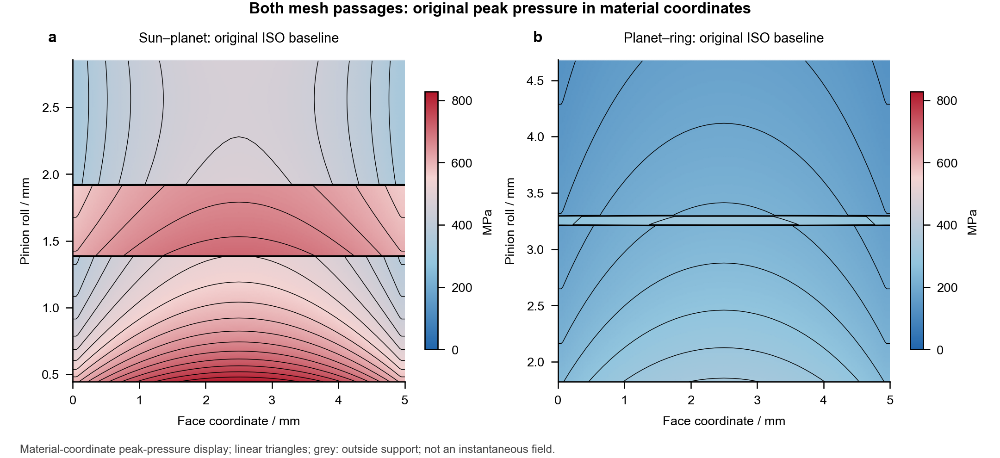
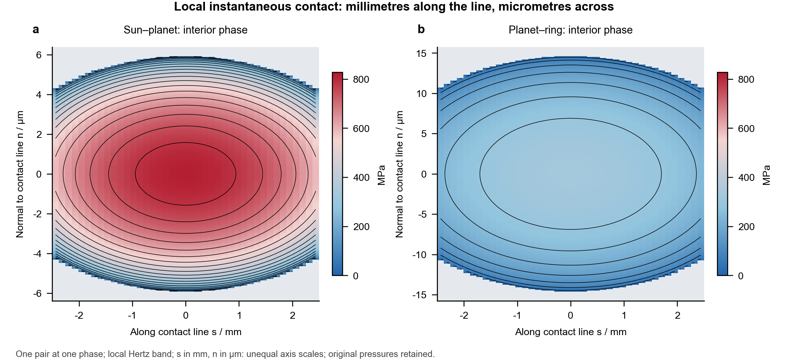
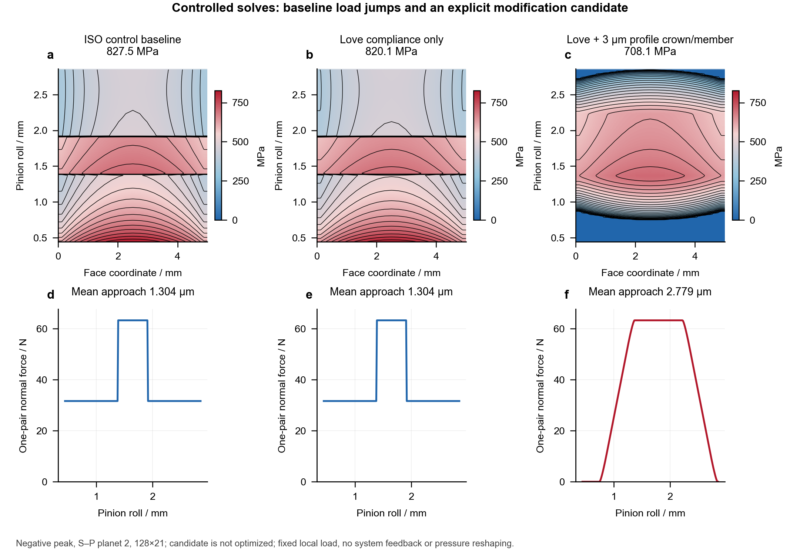
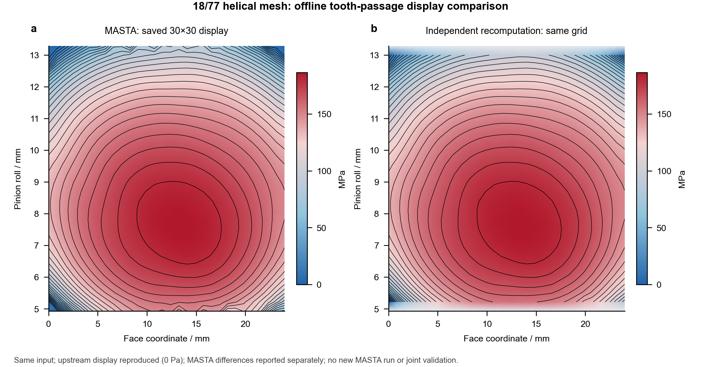

# Contact pressure displays, source reproduction and model limits

[中文](contact_patterns.md) · [English](contact_patterns.en.md)

Version 0.3.1 corrects contact displays against the actual plotting method in the [cylindrical-gear LTCA project](https://github.com/Lilililiyyy/cylindrical-gear-ltca). A **full tooth-passage pressure map** uses face/material-roll coordinates. A **single-pair instantaneous Hertz band** uses local coordinates along the contact line in mm and normal to it in μm. These are distinct quantities and coordinate systems.



## What was corrected

Version 0.3.0 placed a micrometre-scale instantaneous Hertz band on a whole-tooth millimetre-scale roll axis, compressing it into a line. It also treated the maximum envelope of finite bands across phases as the same passage display used by the source project. These postprocessed quantities differ. The former claim of “no interpolation” also misdescribed the source project's passage display. The homepage figures and those descriptions have been replaced.

This version directly follows the source `contact_display.py` material-coordinate sampling and triangular linear interpolation, checking the matching 18/77 case before applying it to both joint meshes. The display adapter is in `robot_joint/`; the existing `gear_contact/` calculation kernel is unchanged. Finite-band postprocessing remains available for diagnostics, but its envelope and sampling-gap fraction no longer define or validate the source-style passage map.

## How the passage pressure map is formed

LTCA solves several neighbouring pairs within one base-pitch period. `tooth_pair_index` identifies a neighbour at the wrapped phase, not a permanent physical-tooth identity. Combining pressure samples from all pairs in the same material coordinates gives a periodic-equivalent full passage under identical-tooth, fixed-local-load and periodic-boundary assumptions. One fixed pair index does not cover the entire passage.

The display follows these steps:

1. Retain original phases, pair identities, face/roll coordinates and local peak pressures. Use independently solved endpoint pressures when available; exclude branches flagged as tip extensions when displaying the ordinary profile.
2. When only strip-centre pressures exist, use those values and extend the first/last centre value to the actual outer strip boundary as display support. These are not newly solved independent endpoint pressures.
3. At duplicate material coordinates, retain the maximum peak pressure as in the source method. Apply triangular linear interpolation to the display grid and draw pressure contours. Interpolation defines the image without changing the LTCA solution.
4. Keep `NaN` outside the support-point convex hull and show it in grey. Zero pressure is at the blue end of the blue/red scale. Grey does not mean solved zero pressure or separation.

The vertical coordinate is the selected member's involute roll and the horizontal coordinate is face position, both displayed in mm. Internal and external meshes retain their respective material-coordinate directions; an internal ring cannot simply inherit the external-mesh sign. Four-member maps separately show the sun, the sun-facing planet flank, the ring-facing planet flank and the ring.

The map shows **local peak-pressure samples and their display interpolation** at material positions. It is not the whole-flank pressure field at one instant, and its area integral is not a simultaneous pair force. The convex hull is not a newly solved contact boundary. Interpolated points inside it have not each been independently solved or proven to contact.

## Fixed states, planets and flanks

Default positive peak `forward_04`, negative peak `reverse_04` and low-load `forward_01` each contain three planets and both meshes: 18 local mesh solves and 36 member displays. Loads and misalignments come from the 64-phase ×26-strip coupled system solution. Local calculations use 512 phases ×41 strips at the frozen state loads and **do not feed back into the original system load sharing or stiffness**. This is not a pressure envelope over all states of the 1.8 s duty.

Low-load `forward_01` has positive speed but negative demanded torque, so it uses the negative flank. Torque sign selects the working flank.

[Positive-flank planets](../examples/results/contact_patterns/en/02_positive_planets.png) · [Negative-flank planets](../examples/results/contact_patterns/en/03_negative_planets.png) · [Low-load state](../examples/results/contact_patterns/en/04_low_load_planets.png) · [Four member flanks](../examples/results/contact_patterns/en/05_members.png)

## Why instantaneous bands need local coordinates



For one pair at a selected interior phase, `s / mm` runs along the contact line and `n / μm` runs normal to it. The axes have different display scales to resolve the micrometre-scale half-width. Their visual aspect ratio is not the physical patch aspect ratio. The band is not laid back onto a whole-tooth roll axis.

Each original strip retains force `Fi`, actual length `wi`, peak pressure `p0` and Hertz half-width `b`. The local band satisfies:

`p(n) = p0 × sqrt(max(0, 1 − (n/b)²))`, nonzero only for `|n| ≤ b`.

`Fi = wi × π × p0 × b / 2`.

That strip-force identity applies to the branch retaining constant centre values. The independent-endpoint branch separately interpolates `p0` and `b` for display, so the integral of their product need not equal the original centre-strip force. `source_*` retains original values without implying display-area force conservation. The API separately reports `source_total_force_n`, `display_integrated_force_n` and `display_relative_force_error`. For 18/77 phase 0, pair 0, the local displayed integral is about 104.464 N against an original strip total of 104.673 N, a difference of about −0.20%. Pressure is not renormalized to conceal it. The default joint ISO case has no independent endpoints and is unaffected by this endpoint-interpolation difference.

Check analytical integrals, display-grid integrals and original forces separately. The identities do not validate passage interpolation or tip-edge physics. The local Hertz model does not re-solve 2D elastic contact at the finite tooth-tip boundary. Selecting an interior phase only avoids using that clipped edge as the instantaneous example.

## Why zones remain: preserve the baseline, compare explicit modifications



The original joint baseline uses the ISO spur-strip model with zero profile crown and zero tip/root relief; original lead modifications are retained. The number of loaded pairs changes between single- and double-pair zones. With zero profile modification, clear pressure zones can remain even under the correct source display method. The reference 18/77 helical case has different modifications and compliance settings; the two models need not produce the same elliptical appearance.

A separate `negative_peak/sun_planet/planet02` diagnostic re-solves an **ISO control baseline**, Love only, and **3 μm profile crown per member plus Love** at 128 phases ×21 strips. At the same load, these cases distinguish compliance-model and explicit-modification effects on pressure transitions, normal approach and stiffness; see the [model-comparison summary](../examples/results/contact_patterns/model_comparison.json). Default-case 512×41 main-workflow input is unchanged. The 3 μm value is a new diagnostic assumption, not measured mjbots/DFKI geometry, an optimization result or prototype validation.

The diagnostic records `source_analysis_input` and `baseline_changes_from_source`. It explicitly forces `elastic_mode="iso"`, `local_contact=False` and a 128×21 grid for the control baseline; arbitrary custom inputs are not described as an unchanged original baseline. `candidate_profile_rule="replace_each_member_with_3um"` replaces each member's `profile_crown_m` with 3 μm rather than adding to any existing crown. The default source already uses ISO and zero profile crown. Explicitly recording these controls does not change the previously calculated 128×21 diagnostic values below; source and control discretizations remain distinct. Composite modifications with `kind` other than `parameters` are unsupported and raise an explicit error.

|Diagnostic model|Raw peak / MPa|Mean normal approach / μm|Source mean mesh stiffness / N·μm⁻¹|Maximum adjacent-sample pair-force change / total normal force|
|---|---:|---:|---:|---:|
|ISO control baseline|827.462|1.30360|62.0245|50.000%|
|Add Love only|820.081|1.30360|62.0245|50.000%|
|Love + 3 μm profile crown per member|708.122|2.77860|51.5135|2.0495%|

Love alone does not remove the original single-/double-pair switch. Explicit crown improves transitions at this discretization, with greater normal approach and lower source mean stiffness. Approach includes the modification's geometric datum and is not pure elastic deflection; mean mesh stiffness here is not output stiffness. Adjacent-sample force changes depend on the 128-phase grid and are neither continuous derivatives nor evidence of all-boundary convergence. None of the three cases recouples system load sharing.

## Reproducing the 18/77 source display



Reproduction re-solves matching 18/77 input, flank and load. Every finite pressure and the `NaN` mask are compared between the retained MASTA display and the current endpoint-based display on the original 30×30 grid, then shown with one blue/red scale. Upstream-display reproduction is checked separately: zero error in reproducing that method does not mean zero error against MASTA. Raw endpoint peaks, interpolated peaks and both comparison types are separate in the [reproduction summary](../examples/results/contact_patterns/reference_reproduction.json).

|Check|Current result|
|---|---:|
|Maximum absolute difference from upstream display|0 Pa; identical NaN mask|
|Common finite MASTA points / current uncovered points|840 / 60|
|MAE / RMSE against the MASTA display|0.040641 / 0.140090 MPa|
|Maximum absolute difference from the MASTA display|2.994763 MPa|
|MASTA / current display peak|186.522329 / 186.524300 MPa|
|Current raw endpoint peak|186.674382 MPa|

This revision uses a retained MASTA reference without running MASTA again. Similar display peaks do not establish full-field agreement. The maximum difference remains visible alongside MAE/RMSE, and endpoint/display peaks are not mixed.

This supplements the existing MASTA single-mesh TE, stiffness and endpoint-pressure comparison. It checks the declared calculation/display chain, not the NGW assembly, an optimized modification or hardware contact. Regression-test counts, visual continuity and local Hertz integral identities cannot replace pointwise checks or independently establish physical accuracy.

## Reproduction and raw data

```bash
python -m examples.build_contact_patterns --phases 512 --strips 41
python -m examples.build_contact_patterns --replot
python -m examples.build_contact_patterns --joint-results output/pendulum --output output/contact
```

Add `--language en` for English only. `--raw-output output/contact_raw` saves additional complete LTCA arrays, diagnostics and CSV. The [default local inputs](../examples/contact_pattern_inputs.json) explicitly record planet torques, material, modifications, misalignment and system-source SHA values; pressure responses are not solver inputs. A custom `export_joint` directory is checked against its manifest.

The [global summary](../examples/results/contact_patterns/summary.json) links states, planets, flanks, discretization and result locations. Each member output retains `pattern.npz`, `summary.json` and a SHA manifest. Lengths use m, pressures Pa and forces N; figures convert to mm/μm/MPa. Original strip fields `phase_index, phase, tooth_pair_index, face_m, roll_pinion_m, roll_wheel_m, strip_width_m, force_n, pressure_pa, half_width_m` trace the solution. Passage display and local instantaneous grids have separate coordinates and cannot be subtracted pixelwise.

|Added array|Layout and meaning|
|---|---|
|`pass_face_coordinate_m`, `pass_roll_distance_m`|1D passage-display face and material-roll coordinates|
|`pass_pressure_pa_x_y`|[face points, roll points]; interpolated display pressure, NaN outside the hull|
|`pass_samples`, `pass_ordinary_samples`|Original pressure points and ordinary-profile points after extension exclusion|
|`pass_boundary_display_samples`|Constant boundary display support for centre-only models; no extra extension for independent endpoint models|
|`local_s_edges_m`, `local_normal_edges_m`|Local instantaneous along-line/normal cell edges|
|`local_pressure_pa_s_n`|[along-line cells, normal cells]; local Hertz pressure of one pair at one phase|

```python
from robot_joint.contact_display import contact_pass_data, instantaneous_contact_data

passage = contact_pass_data(contact, samples=(201, 241))
instant = instantaneous_contact_data(contact, normal_points=301)
```

`contact_pass_data` accepts `face_coordinate_m` and `roll_distance_m` to reuse a reference grid and returns corresponding fields without the `pass_` prefix. `instantaneous_contact_data` accepts `phase_index` and `tooth_pair_index` for explicit selection and returns `s_edges_m`, `normal_edges_m`, `pressure_pa_s_n` and `source_*` values, separately recording the original force, display integral and relative difference. See [the API](api.en.md) for complete signatures and the drawing function. `--replot` still verifies SHA manifests first.

Read display data separately from solved values. Legacy finite-band envelope fields such as `sweep_pressure_pa` are compatibility diagnostics; their names do not imply that the current homepage still uses that algorithm. SVG/PDF labels and axes remain editable, while pressure layers are rasterized. A denser display grid adds no solver samples.

The joint case uses non-extended spur internal/external meshes. The 18/77 helical reproduction is a separate single-mesh display check, not helical NGW system support. None of these plots is 2D/3D FE contact, a marking-compound test, lubricant-film pressure or hardware validation.
