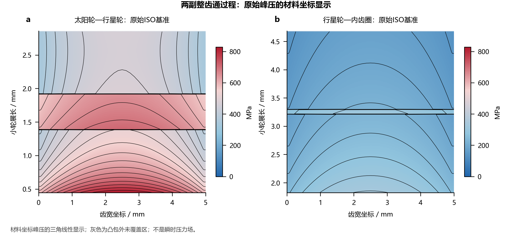
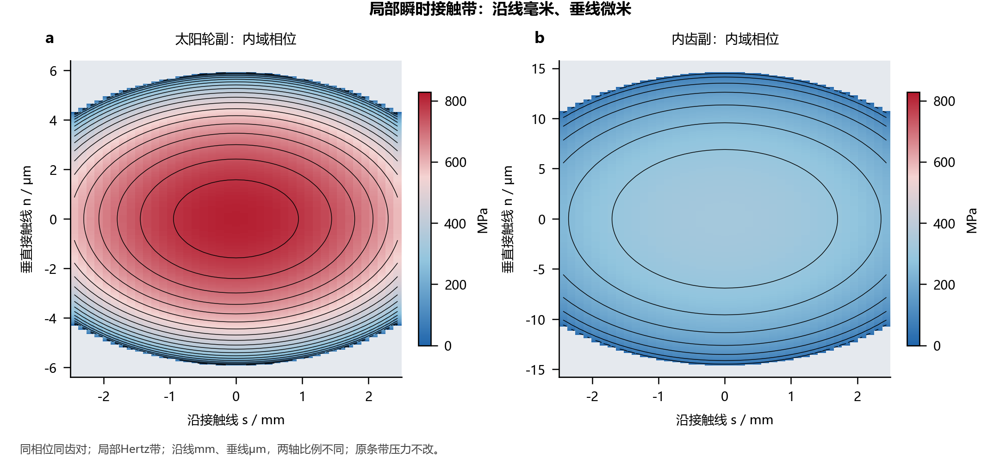
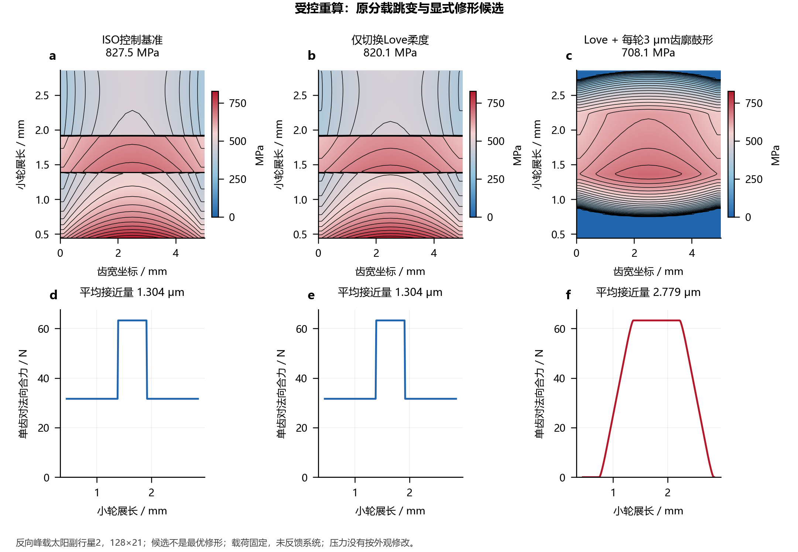
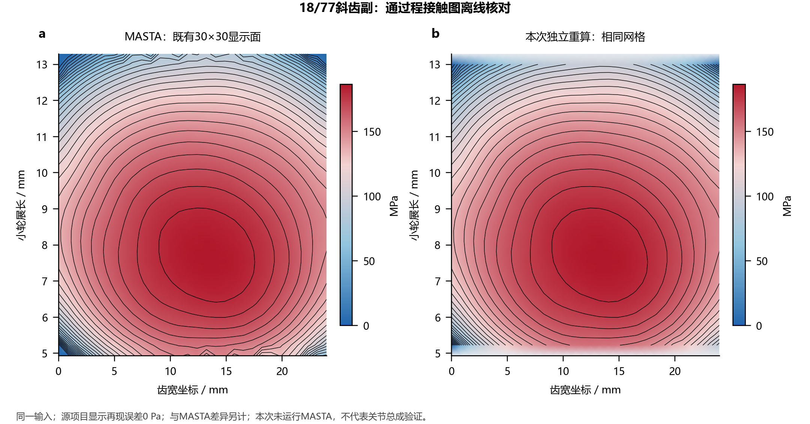

# 接触压力显示、源项目复现与模型边界

[中文](contact_patterns.md) · [English](contact_patterns.en.md)

0.3.1按[圆柱齿轮LTCA项目](https://github.com/Lilililiyyy/cylindrical-gear-ltca)的实际绘图方法纠正接触显示。**整齿通过程压力图**采用齿宽—材料展长坐标；**一对齿瞬时Hertz带**采用沿接触线mm、垂直接触线μm的局部坐标。这是两种不同的量和坐标，不能互相替代。



## 本次纠正了什么

0.3.0把瞬时微米级Hertz带画在整齿毫米级展长轴上，带宽被压成细线；又把多相位有限带的最大值包络作为与源项目相同的通过程图。这两个后处理对象并不相同，原文“没有插值”的说明也不适用于源项目的通过程显示。旧主页图及相关表述已替换。

本版直接沿用源项目`contact_display.py`的材料坐标采样与三角线性插值方法，先在相同18/77案例验证，再用于关节内外两副。显示适配位于`robot_joint/`；原有`gear_contact/`计算内核保持不变。既有有限带后处理仍可作诊断，但其包络和采样空隙比例不再作为源项目通过程图的定义或正确性证据。

## 通过程压力图如何形成

源LTCA在一个基节周期内同时求解多对相邻齿。`tooth_pair_index`是包装相位内的相邻齿编号，不是固定物理齿的永久身份。把一个周期中所有齿对的压力样本放到相同材料坐标，在相同齿、固定局部载荷及周期边界假设下，得到一次周期等价的完整齿通过程。固定编号的一对齿不能独自覆盖整个过程。

显示遵循以下步骤：

1. 保留原始相位、齿对、齿宽/展长坐标及局部峰压。存在独立端点压力时使用原端点，并排除标记为齿顶延伸的分支，显示普通齿廓。
2. 只有条带中心压力时使用中心值，并把首末中心值延至原条带的实际外边界，作为显示支撑；这不是新增求得的独立端点压力。
3. 重合材料坐标按源方法取最大峰压，再用三角线性插值投到显示网格，叠加等压线。插值只定义图面，不改变LTCA原始解。
4. 支撑点凸包外保留`NaN`并显示为灰色。零压力位于蓝红色标的蓝端；灰色不等于求解得到的零压或脱开。

纵轴为所选构件自身的渐开线展长，横轴为齿宽坐标，图中均用mm；内啮合和外啮合各自保留材料坐标方向，不能把内齿圈复制为外啮合反号。四构件图分别显示太阳轮、太阳侧行星齿面、内齿侧行星齿面及内齿圈。

这张图显示各材料位置经历的**局部峰压样本及其显示插值**。它不是同一时刻整个齿面的压力场，其面积积分不等于瞬时齿对合力。凸包也不是新求得的接触边界；其内部的线性插值不证明每个显示点都曾独立求解或接触。

## 固定工况、行星与工作面

默认正向峰载`forward_04`、反向峰载`reverse_04`和低载`forward_01`各含3颗行星、内外两副，共18次局部啮合求解、36个构件显示。系统载荷与失准来自64相位×26条带协调结果；局部重算采用512相位×41条带，冻结该工况的局部载荷，**不反向修改原系统分载或刚度**。这不是1.8 s任务中全部工况的压力包络。

低载`forward_01`角速度为正、需求扭矩为负，因此采用negative工作面。工作面由扭矩符号决定。

[正工作面三行星](../examples/results/contact_patterns/zh/02_positive_planets.png) · [反工作面三行星](../examples/results/contact_patterns/zh/03_negative_planets.png) · [低载工况](../examples/results/contact_patterns/zh/04_low_load_planets.png) · [四构件齿面](../examples/results/contact_patterns/zh/05_members.png)

## 瞬时带为何必须使用局部坐标



在一个选定内域相位的一对齿上，沿接触线用`s / mm`，垂直接触线用`n / μm`。两轴显示比例不同，便于看清微米级半宽，不能直接按图上长宽比判断实体斑点比例。该图没有把瞬时带重新铺到整齿展长上。

各原条带保留力`Fi`、实际长度`wi`、峰压`p0`和Hertz半宽`b`。局部带满足：

`p(n) = p0 × sqrt(max(0, 1 − (n/b)²))`，仅在`|n| ≤ b`内非零。

`Fi = wi × π × p0 × b / 2`。

上述条带合力恒等式适用于保留中心值常数的分支。独立端点分支为显示而分别线性插值`p0`与`b`，其乘积积分不严格等于原中心条带力；`source_*`保存原值，不表示显示面积积分守恒。接口另报`source_total_force_n`、`display_integrated_force_n`及`display_relative_force_error`。18/77相位0、齿对0的局部显示积分约104.464 N，原条带合力约104.673 N，相对差约−0.20%；不通过重新归一化改动压力来掩盖该差异。默认关节ISO案例没有独立端点，不受这一端点插值差异影响。

解析积分、显示栅格积分及原条带力应分别核对，不能据恒等式验证通过程插值或齿顶边缘物理。局部Hertz模型没有在有限齿顶边界重新求解二维弹性接触；选择内域相位只避免把该边缘裁剪作为瞬时示例。

## 分区来自哪里：保留基准，显式比较修形



关节原基准为直齿ISO条带模型，齿廓鼓形、齿顶/齿根修缘为零，原齿向修形保留。单齿区与双齿区的承载齿数发生切换，零齿廓修形下会出现明显压力分区。即使采用源项目相同的显示方法，这种分区仍可能存在；参考18/77斜齿案例带有不同的修形和柔度设置，不能要求两个不同模型具有相同椭圆外观。

另选`negative_peak/sun_planet/planet02`，以128相位×21条带重新求解**ISO控制基准**、仅Love及**每轮3 μm齿廓鼓形+Love**三组。在相同载荷下分别比较柔度模型和显式修形对压力过渡、法向趋近与刚度的影响，详见[模型比较摘要](../examples/results/contact_patterns/model_comparison.json)。默认案例512×41主流程输入不变。3 μm是新增诊断假设，不是mjbots/DFKI实物修形数据，也不是优化或样机验证。

诊断脚本单列`source_analysis_input`与`baseline_changes_from_source`：控制基准显式强制`elastic_mode="iso"`、`local_contact=False`及128×21离散，不把任意自定义输入称为未经修改的原基准。候选规则`candidate_profile_rule="replace_each_member_with_3um"`表示将两轮`profile_crown_m`分别替换为3 μm，而非在任意原鼓形上累加。默认来源原本为ISO、零齿廓鼓形，本次显式记录控制设置不会改变下表既有128×21诊断数值；来源离散与控制离散仍分别保存。`kind`不是`parameters`的组合修形不支持，明确报错。

|诊断模型|原解峰压 / MPa|平均法向趋近 / μm|源汇总平均啮合刚度 / N·μm⁻¹|最大相邻样本齿对力差/总法向力|
|---|---:|---:|---:|---:|
|ISO控制基准|827.462|1.30360|62.0245|50.000%|
|仅增加Love|820.081|1.30360|62.0245|50.000%|
|Love + 每轮3 μm齿廓鼓形|708.122|2.77860|51.5135|2.0495%|

仅Love没有消除原单/双齿切换；显式鼓形改善了该离散下的过渡，但伴随更大的法向趋近和更低的源平均刚度。趋近包含修形几何基准，不能直接理解为纯弹性变形；这里的平均啮合刚度也不是输出刚度。相邻样本力差取决于128相位离散，不是连续解导数或全边界收敛证据。三组均未重新协调系统分载。

## 18/77源项目显示复现



复现按相同18/77输入、工作面及载荷重新求解，将MASTA保存显示场与本次重算端点的显示场在原30×30网格上核对每个有效压力值及`NaN`掩码，再用相同蓝红色标并列显示。同时核对上游项目显示方法的再现误差；即使该再现误差为零，也不等于MASTA对标误差为零。原端点峰压、插值后显示峰压与两类比较分别记录于[复现摘要](../examples/results/contact_patterns/reference_reproduction.json)。

|核对项|本次结果|
|---|---:|
|与上游显示方法最大绝对差|0 Pa，NaN掩码相同|
|MASTA共同有效点 / 本项目未覆盖点|840 / 60|
|相对MASTA显示场MAE / RMSE|0.040641 / 0.140090 MPa|
|相对MASTA显示场最大绝对差|2.994763 MPa|
|MASTA / 本项目显示峰压|186.522329 / 186.524300 MPa|
|本项目原端点峰压|186.674382 MPa|

本轮使用已保存MASTA参照，没有重新运行MASTA。显示峰值接近不能代替全场误差；最大差与MAE、RMSE一起保留，不将原端点峰压与显示峰压混算。

这项核验补充已有的MASTA单副TE、刚度和端点压力对标。它验证所列案例的计算/显示链路，不验证NGW总成、修形优化或样机接触。一般回归测试数量、图面连续、局部Hertz积分恒等式均不能替代这项逐点核对，更不能独自建立物理准确性。

## 复算与原始数据

```bash
python -m examples.build_contact_patterns --phases 512 --strips 41
python -m examples.build_contact_patterns --replot
python -m examples.build_contact_patterns --joint-results output/pendulum --output output/contact
```

只需英文时加`--language en`；`--raw-output output/contact_raw`另存完整LTCA数组/诊断/CSV。[默认局部输入](../examples/contact_pattern_inputs.json)明确记录各行星扭矩、材料、修形、失准及系统来源SHA，压力响应不作为求解输入。自定义`export_joint`目录按其清单核验。

[全局摘要](../examples/results/contact_patterns/summary.json)关联工况、行星、工作面、离散及结果位置。每份齿面输出保留`pattern.npz`、`summary.json`和SHA清单。长度m、压力Pa、力N，图中另转mm/μm/MPa。原条带的`phase_index, phase, tooth_pair_index, face_m, roll_pinion_m, roll_wheel_m, strip_width_m, force_n, pressure_pa, half_width_m`用于追溯原解；显示网格及局部瞬时网格具有各自坐标，不能逐像素相减。

|新增数组|布局与含义|
|---|---|
|`pass_face_coordinate_m`、`pass_roll_distance_m`|通过程的一维齿宽、材料展长显示坐标|
|`pass_pressure_pa_x_y`|[齿宽点, 展长点]；显示插值压力，凸包外NaN|
|`pass_samples`、`pass_ordinary_samples`|原压力点、排除延伸分支后的普通齿廓点|
|`pass_boundary_display_samples`|中心模型的边界常值显示支撑，独立端点模型不额外延拓|
|`local_s_edges_m`、`local_normal_edges_m`|瞬时局部沿线、法向单元边界|
|`local_pressure_pa_s_n`|[沿线单元, 法向单元]；同一相位一对齿的局部Hertz压力|

```python
from robot_joint.contact_display import contact_pass_data, instantaneous_contact_data

# contact为逐行星、逐副的原gear_contact.AnalysisResult。
passage = contact_pass_data(contact, samples=(201, 241))
instant = instantaneous_contact_data(contact, normal_points=301)
```

`contact_pass_data`可传`face_coordinate_m`、`roll_distance_m`复用参照网格；返回未加`pass_`前缀的对应字段。`instantaneous_contact_data`可传`phase_index`和`tooth_pair_index`选相选齿，返回`s_edges_m`、`normal_edges_m`、`pressure_pa_s_n`及`source_*`原值，并分别记录原合力、显示积分及其相对差。完整签名和绘图函数见[接口说明](api.md)。`--replot`仍先校验SHA清单。

显示数据与原求解值应分别读取。旧`sweep_pressure_pa`等有限带包络字段属于兼容诊断，不能据字段名推断本版主页图仍采用该算法。SVG/PDF文字与坐标可编辑，压力图层按栅格导出；更密的显示网格不增加求解样本。

当前关节案例为无齿顶延伸的直齿内/外啮合。18/77斜齿复现属于独立单副显示核验，不表示NGW系统已支持斜齿。所有上述图均不是二维/三维FE接触、涂色试验、润滑膜压力或硬件验证。
