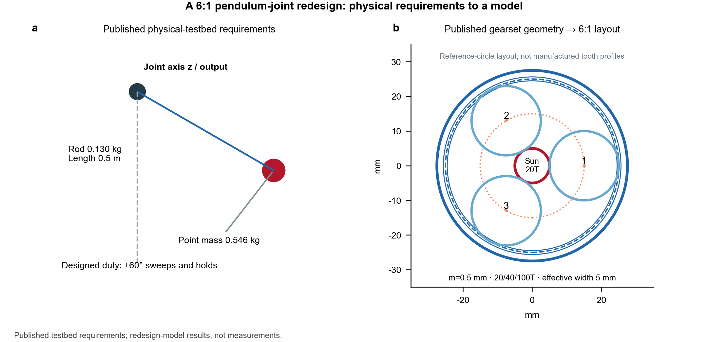
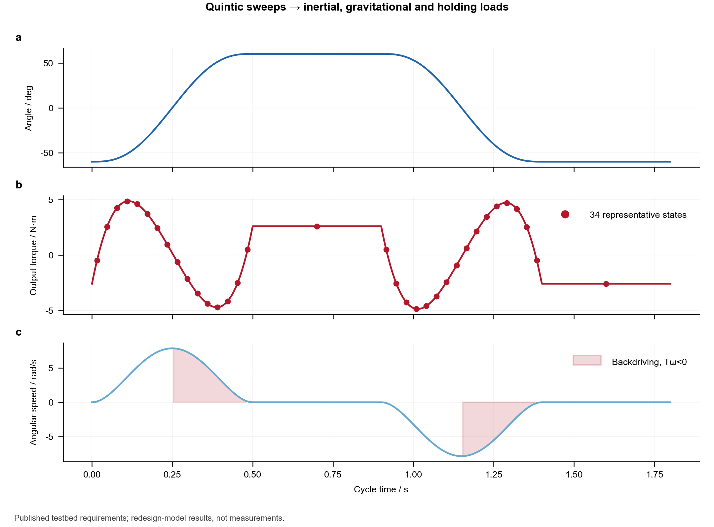
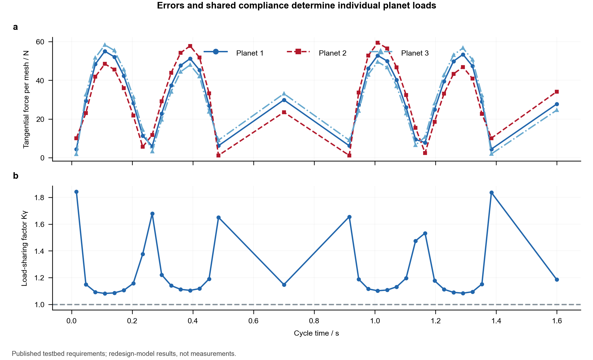
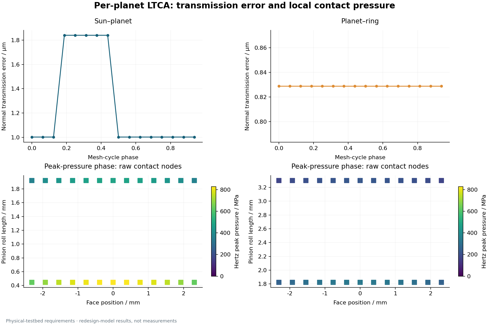
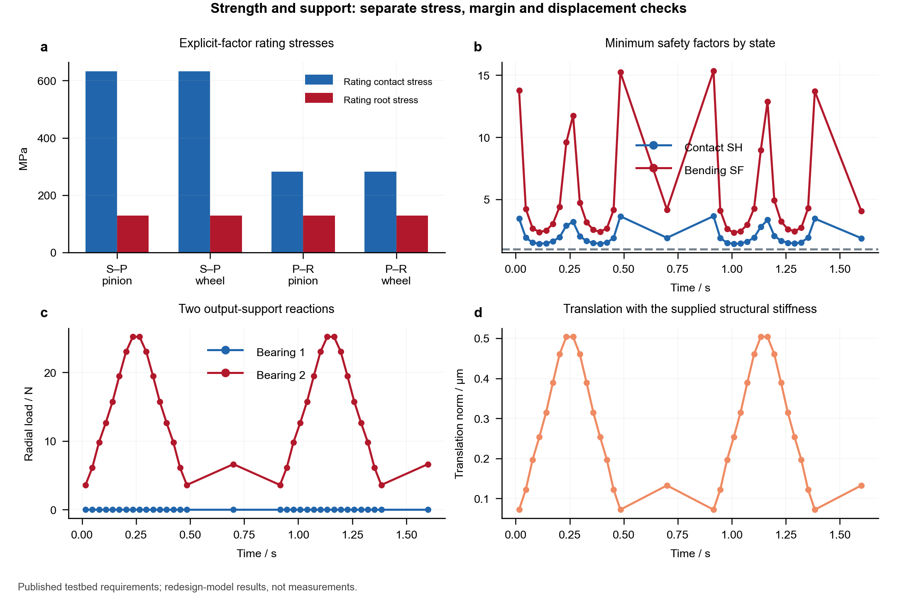
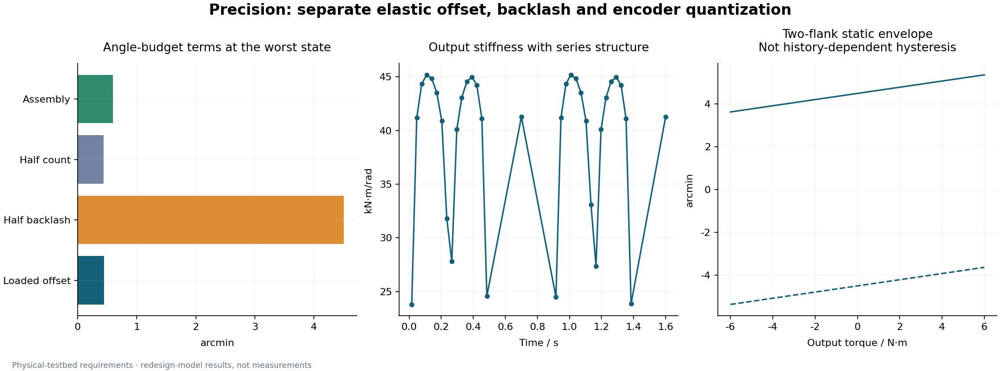
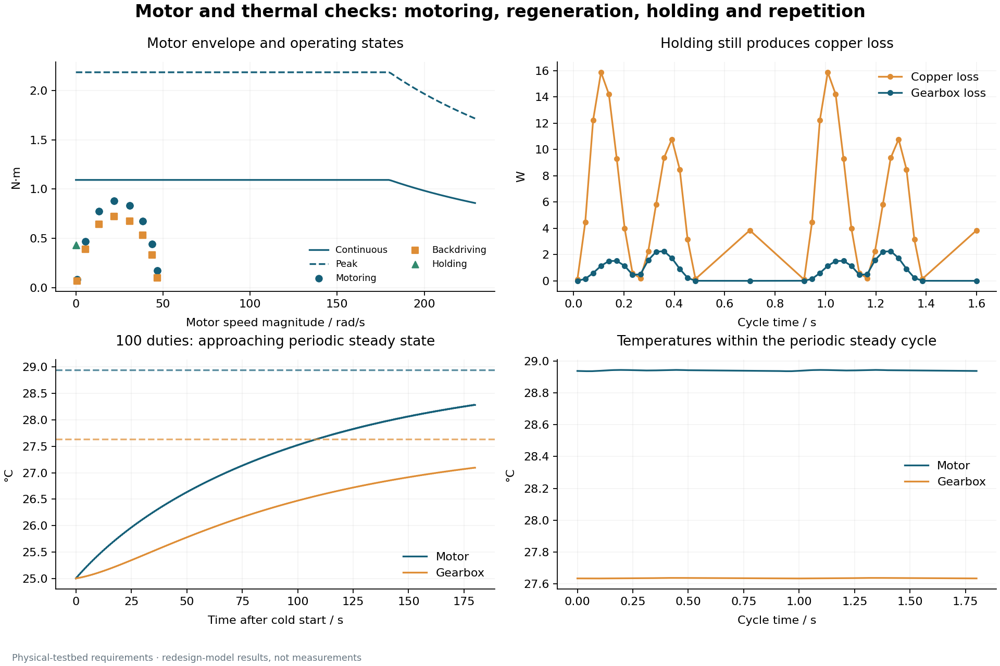
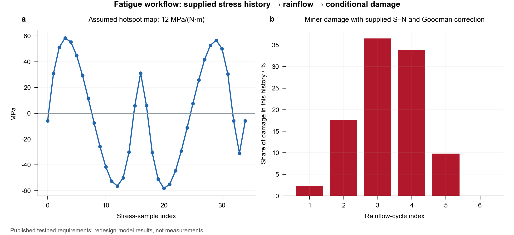
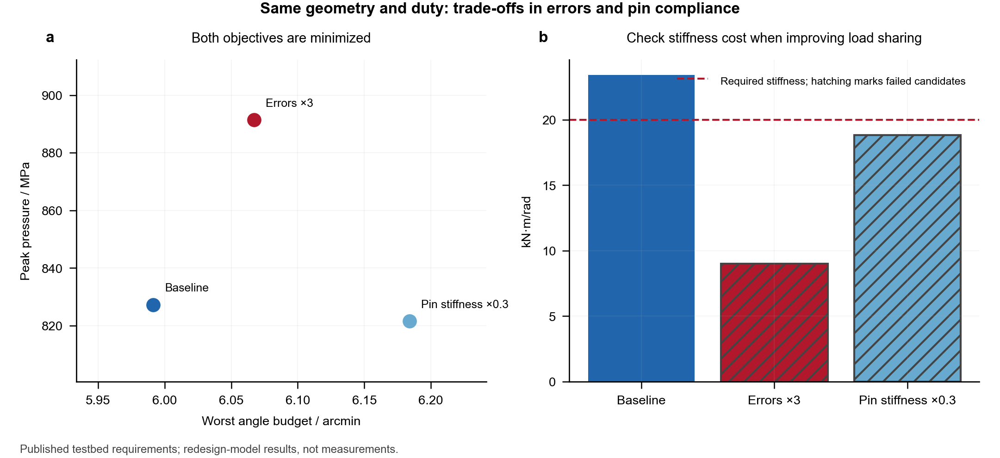
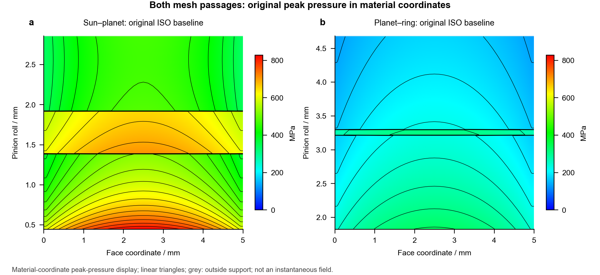

# DFKI pendulum requirements: complete 6:1 joint design case

[中文](examples.md) · [English](examples.en.md)

**Follow a 6:1 robot-joint transmission design from published physical-testbed requirements to engineering checks.**

[Back to the project](../README.en.md). Run all commands below from the project root.

This parameterized NGW calculation kernel connects loads, geometry, materials, tooth modifications, support, motor and thermal inputs. It exports raw contact arrays, engineering results, a Chinese calculation report and CAD/BOM parameters. The calculation modules run as a self-contained project.

## Case: redesigning the joint transmission for a physical DFKI pendulum

The [DFKI hardware documentation](https://github.com/dfki-ric-underactuated-lab/torque_limited_simple_pendulum/blob/11a946d4e6db58d001fdeff89be269eb61461757/hardware/testbench_description.md) provides a 0.546 kg point mass, a 0.130 kg rod/mounting assembly and a 0.5 m length. Its original actuator has a 6:1 ratio and 6/12 N·m rated/peak output torque. The redesign uses the geometry of a [public mjbots steel gearset](https://mjbots.com/products/m05-6x-planetary-gearset). **This is a source-grounded new design calculation, not a reconstruction of AK80-6 internals or a replay of measured testbed performance.**



|Input|Value|Basis|
|---|---:|---|
|Total mass / pendulum length|0.676 kg / 0.5 m|Published DFKI hardware data|
|Sun / planet / ring|20 / 40 / 100 teeth|Published gearset geometry|
|Module / planet count|0.5 mm / 3|Published gearset geometry|
|Effective face width|5 mm|Planet/ring width; published sun tooth length is 6 mm|
|Pressure angle / shift|20° / zero|Model assumptions|
|Designed motion|±60°; 0.5 s moves and 0.4 s holds|New 1.8 s design duty|
|Uniform-rod inertia / center of mass|0.147333 kg·m² / 0.451923 m|Derived mass model; published COM is approximately 0.45 m|

Modifications, support, bearing coefficients, rating factors and stress limits, efficiencies, thermal parameters, the hotspot stress map and S–N data are **design inputs not calibrated against this hardware**. See the [requirements and provenance](../examples/dfki_pendulum_requirements.json) and [solver input](../examples/dfki_pendulum_case.json).

The supplier calls 30 mm a center distance, whereas `a=m(zs+zp)/2` gives 15 mm for the stated zero-shift geometry. This model uses 15 mm and retains the 30 mm statement as unresolved. The drawing shows parameter circles, not manufactured tooth profiles.

## 1. Turn motion requirements into loads

Quintic sweeps have zero endpoint velocity and acceleration. The point-mass/uniform-rod model gives `T=Iα+g(mpL+mrL/2)sinθ+bω` and a consistent six-component output load for the support and transmission. A stationary hold still requires gravitational torque.



The 34 saved midpoint states reach **4.8570 N·m**. A dense analytical trajectory reaches 4.8664 N·m, a 0.195% difference. This checks duty discretization only; it does not establish LTCA phase/strip convergence.

## 2. Resolve individual planet loads

Supply flank-specific path errors, pin stiffness, shared sun translation and optional condensed compliance. Nonnegative path forces are solved together with cycle-averaged contact displacement and tangent/intercept feedback. Iteration checks both torque equilibrium and path compatibility.



The maximum load-sharing factor is **1.8439**, with at least 3 planets carrying load simultaneously. Micrometer-scale errors produce unequal loads; paths can unload and re-enter rather than receiving a fixed one-third share.

## 3. Per-planet LTCA: transmission error, stiffness and local pressure

Each state analyzes both meshes for all three planets, using 64 mesh phases and 26 strips per contact line. The figure selects the highest-pressure state and the most heavily stressed planet in each mesh. The upper panels show normal transmission error; the lower panels retain raw loaded contact nodes at the peak-pressure phase.



Maximum local Hertz pressure is **827.21 MPa**. This figure retains original contact nodes, unlike the passage interpolation below. Neither adds a 2D flank-pressure solve. Normal TE, local pressure and output angle budget are different quantities.

## 4. Check rating stresses and support separately

Geometry, local nominal force and elastic properties enter the ISO 6336:2006 explicit-factor stress chain. Tooth-form, stress-correction and load factors, together with material limits, are supplied inputs. These scalar rating stresses are evaluated separately from local Hertz pressure.



Minimum contact and bending safety factors are **1.424** and **2.327**. A supplied six-DOF condensed stiffness gives structural displacement; two-support reactions follow span and load offset. Here the load lies in one support plane, explaining the nearly zero radial reaction at the other bearing.

The two output bearings also receive revolution-weighted basic L10 and static checks. Minimum static safety is 59.56. The light-load basic formula gives approximately 2.34e+09 h; **this is not a physical service-life prediction**. Small-angle oscillation, fretting, lubrication and planet needle-bearing failure are outside this output-support model.

## 5. Output precision and stiffness

Planetary and output-structure compliances are placed in series. The deterministic budget adds the magnitudes of loaded angular offset, half-backlash, half an encoder count and assembly error. This case uses the published 0.15° total backlash and a 12-bit motor-side encoder; input quantization is referred through the ratio.



The worst angle budget is **5.991 arcmin** and minimum output stiffness is **23.432 kN·m/rad**. This is not compensated closed-loop positioning accuracy. The two-flank curves are static envelopes, not history-dependent friction hysteresis.

## 6. Motor, brake and periodic temperature

Motoring and backdriving use separate supplied efficiencies. Rotor inertia is included; the code screens torque–speed envelopes, duration-weighted RMS and input-side static brake requirements. `Req=(Kt/Km)²` establishes a consistent copper-loss basis instead of directly mixing phase resistance and incompatible current conventions.



Current RMS is 5.535 A. With the supplied thermal network, periodic peak motor/gearbox temperatures are **28.944 / 27.638 °C**. The cold-start plot shows 100 repeated duties approaching that cycle. Thermal parameters and the envelope knee are assumptions, so these are not temperature predictions for the original actuator.

## 7. Fatigue: demonstrate the stress-to-damage interface

An explicitly assumed hotspot coefficient of 12 MPa/(N·m) generates a signed scalar stress history. Rainflow, supplied S–N data, tensile-mean Goodman correction and Miner accumulation then evaluate that history. This is separate from gear rating and is not a tooth-root fatigue history recovered from LTCA.



Conditional damage for the input history is **2.811e-07**. It is not whole-joint damage. Repeated truncated records require consistent ordering and residual half-cycle handling before any conversion to service hours.

## 8. Compare design choices under the same duty

Tooth counts, module, materials and motion are held constant. Only path errors or pin compliance change, avoiding reuse of old rating factors after a geometry change. The results expose the trade-off among load sharing, pressure and output stiffness.



|Candidate|Peak pressure / MPa|Angle budget / arcmin|Minimum output stiffness / kN·m/rad|New constraints|
|---|---:|---:|---:|---|
|Baseline|827.21|5.991|23.432|Pass|
|Path errors ×3|891.44|6.067|9.013|Fail: stiffness, sharing|
|Pin stiffness ×0.3|821.52|6.184|18.829|Fail: stiffness|

Larger errors increase the adverse contact load. Softer pins can improve sharing while increasing output compliance. Pareto comparison covers the supplied finite candidates, not a continuous global optimum.

## 9. Reproduce the case and integrate the kernel

```bash
python -m pip install ".[plots]"
python -m robot_joint examples/dfki_pendulum_case.json --output output/pendulum
python -m examples.build_showcase --output output/showcase --raw-output output/raw
python -m examples.compare_designs --output output/comparison.json
```

Alternatively, copy `robot_joint/`, `gear_contact/` and the license into your application:

```python
import json
from pathlib import Path
from robot_joint import analyze_joint, export_joint

config = json.loads(Path("examples/dfki_pendulum_case.json").read_text(encoding="utf-8"))
result = analyze_joint(config)
export_joint(result, "output/pendulum")
```

Outputs include raw contact NPZ/CSV, loads and diagnostics, rating stresses and safety factors, motor/thermal/bearing/fatigue results, `cad_parameters.json`, `bom.csv`, `layout.svg` and a Chinese calculation report. CAD/BOM exports are parameter interfaces, not manufacturing solids or procurement part numbers.

Shared chart data are in [metrics.json](../examples/results/dfki_pendulum/metrics.json) and [duty.csv](../examples/results/dfki_pendulum/duty.csv); editable SVG/PDF files accompany the PNGs. Full internal raw runs are not duplicated among the selected showcase files; the commands above regenerate every contact node. Units are m, rad, N, N·m, Pa, s and K.

## Scope and verification

The model covers a fixed-ring, sun-input, carrier-output, zero-shift spur NGW stage with small deformation, quasi-static response and cycle-mean coupling. New system modules have analytical/equation and numerical checks, but no vendor whole-system benchmark or hardware validation. RV/harmonic drives, full FE, measured hysteresis, control, electromagnetic and lubrication prediction are outside this release. Existing single-mesh comparisons do not certify the whole joint.

See the [model](../docs/model.en.md) and [API contract](../docs/api.en.md). The license is [AGPL-3.0-only](../LICENSE); see [source and license notices](../THIRD_PARTY_NOTICES.md). This page provides the complete physical-requirement-based walkthrough and nine paired figure sets. See the [validation record](validation.en.md) for single-mesh software comparisons and public references, and the [project roadmap](../README.en.md#release-history-and-next-steps) for calibration priorities.


## Contact results and integrated design

[Contact analysis](contact_patterns.en.md) covers all planets, both meshes, loaded flanks and member material coordinates. Local instantaneous bands use mm along the line and μm normal to it.



The [integrated input](../examples/dfki_with_screens.json) uses the assumed 6 mm pin's calculated stiffness, planet-bearing static safety and a 4700 μF bus. Geometry, allowable stresses and electrical parameters remain explicit case assumptions.

```bash
python -m robot_joint examples/dfki_with_screens.json --output output/integrated --plots
```
