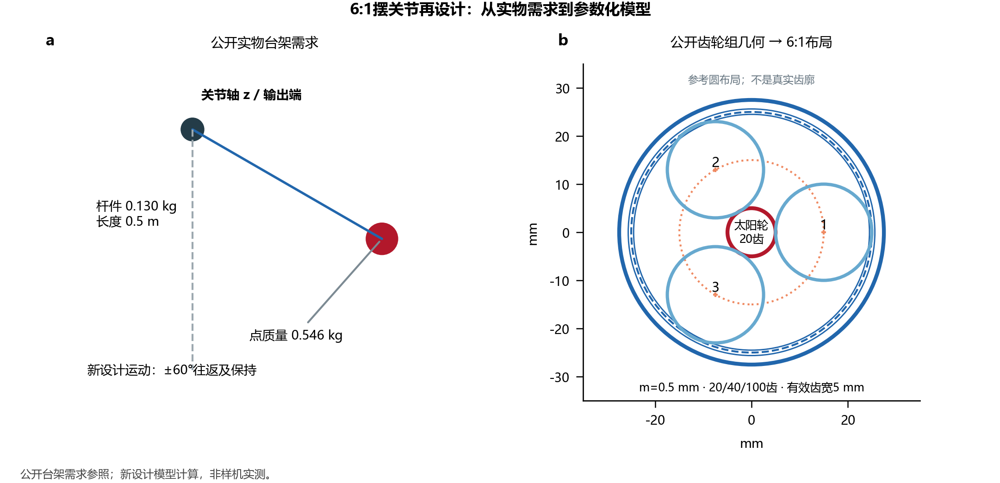
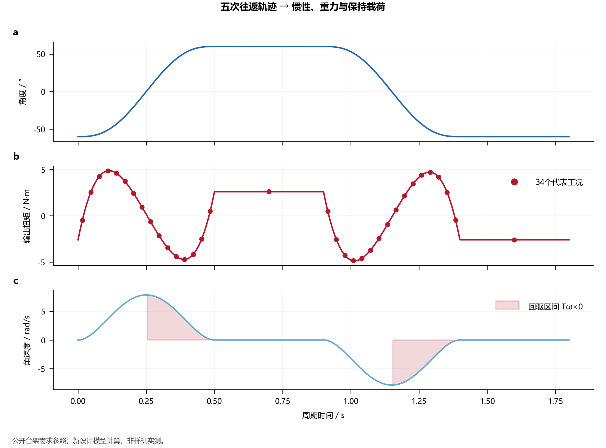
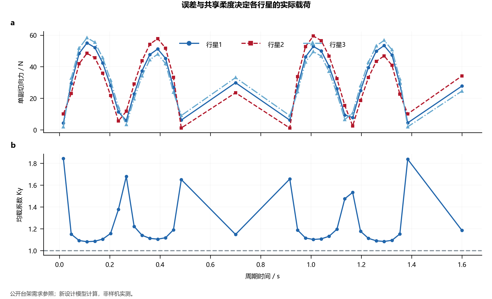
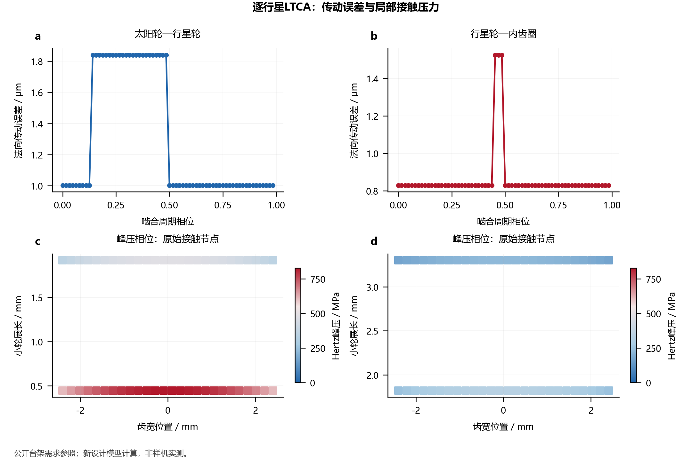
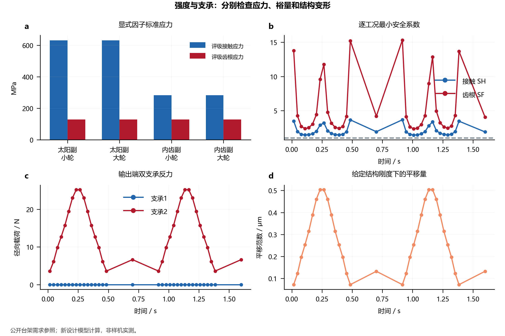
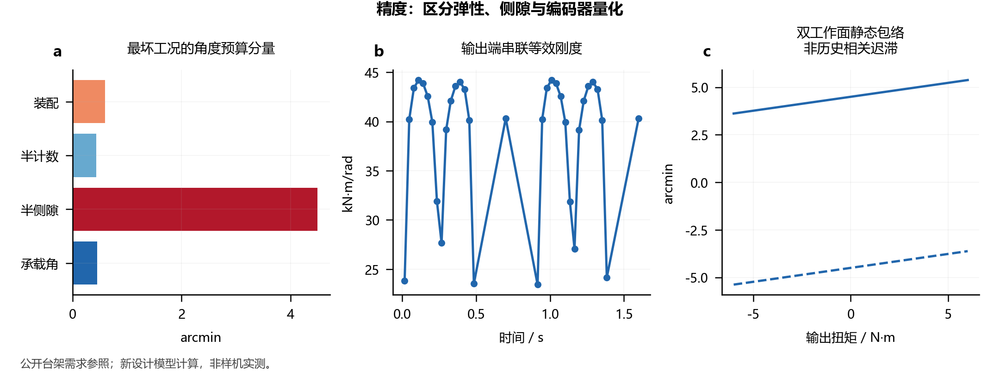
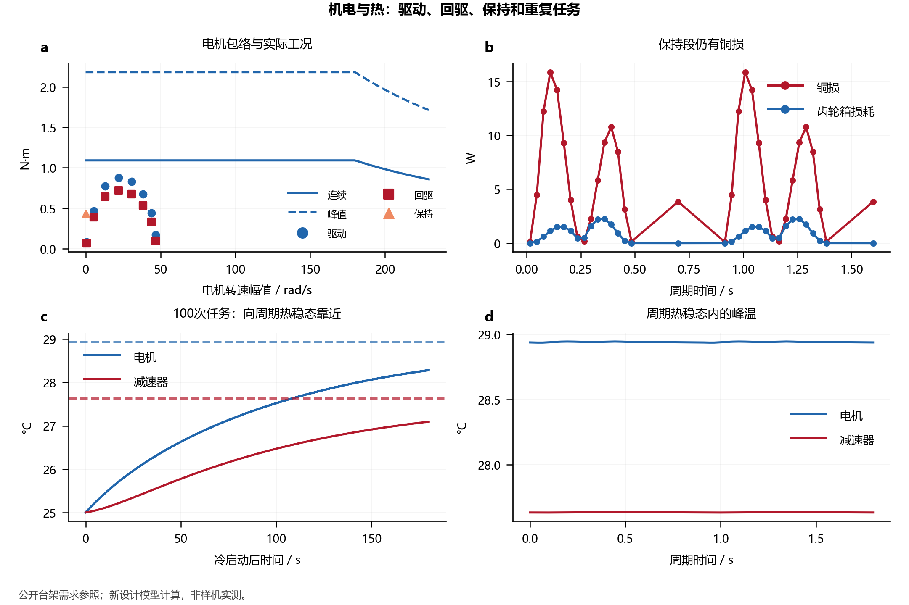
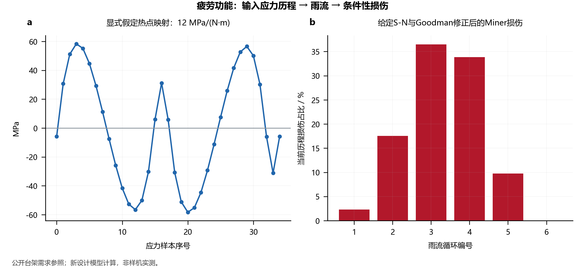
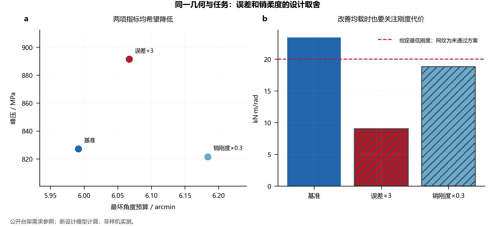

# DFKI摆台需求参照：6:1关节设计完整案例

[中文](examples.md) · [English](examples.en.md)

**以一套公开实物摆台的需求，走完6:1机器人关节的传动设计与校核。**

[返回项目主页](../README.md)。以下命令均在项目根目录运行。

本项目是单级NGW关节的参数化计算内核：把载荷、几何、材料、修形、支承、电机和热参数连接成可复算的设计流程，输出原始接触数组、性能指标、中文计算报告和CAD/BOM参数。当前版本 **0.2.0**，运行不依赖商业软件或厂商DLL。

## 案例：DFKI实物摆台的关节传动再设计

需求来自[DFKI公开台架资料](https://github.com/dfki-ric-underactuated-lab/torque_limited_simple_pendulum/blob/11a946d4e6db58d001fdeff89be269eb61461757/hardware/testbench_description.md)：摆端质量0.546 kg、杆及连接件0.130 kg、长度0.5 m，原驱动器为6:1、输出额定/峰值6/12 N·m。再设计的齿轮几何参照[mjbots公开钢齿轮组](https://mjbots.com/products/m05-6x-planetary-gearset)。**这是以真实需求为依据的新设计计算，不是对AK80-6内部结构的复原，也不是原台架实测数据回放。**



|输入|取值|性质|
|---|---:|---|
|总质量、摆长|0.676 kg、0.5 m|DFKI公开硬件数据|
|太阳轮/行星轮/内齿圈|20 / 40 / 100齿|公开齿轮组几何|
|模数、行星数量|0.5 mm、3颗|公开齿轮组几何|
|有效齿宽|5 mm|取行星轮/内齿圈宽度；太阳轮公开齿长6 mm|
|压力角、变位|20°、零变位|本次模型假设|
|往返运动|±60°；每次移动0.5 s、保持0.4 s|新设计任务，周期1.8 s|
|均匀细杆模型的惯量/质心|0.147333 kg·m² / 0.451923 m|由质量分布推导；公开COM约0.45 m|

修形、支承、目录系数、外部评级因子与应力限、效率、热参数、热点应力映射和S-N数据均是**未经过该实物台架标定的设计输入**。逐项数据与来源见[需求文件](../examples/dfki_pendulum_requirements.json)和[计算输入](../examples/dfki_pendulum_case.json)。

供应页将中心距写为30 mm，而零变位同模数关系`a=m(zs+zp)/2`给出15 mm。本模型采用15 mm；30 mm表述单独保留为待确认信息。图中的圆线是参数布局，不是制造齿廓。

## 1. 从运动任务得到载荷

采用端点速度与加速度均为零的五次往返轨迹。细杆与点质量模型给出`T=Iα+g(mpL+mrL/2)sinθ+bω`，同时生成输出端六分量载荷，供支承与传动共同使用。保持段转速为零，仍需抵抗重力。



保存的34个中点代表工况峰值扭矩为 **4.8570 N·m**；密集解析轨迹峰值为4.8664 N·m，差异0.195%。这项核验只评价运动载荷离散，不替代LTCA相位/条带收敛检查。

## 2. 从总扭矩求各行星载荷

输入两工作面的路径误差、行星销刚度、太阳轮共享平移与额外凝聚柔度，求解非负路径载荷。内外两副接触计算的位移和局部切线反馈到系统，迭代检查力矩平衡与路径位移协调。



本例最大均载系数 **1.8439**，最少同时承载行星数为3。给定的微米级误差使载荷并非固定三等分；低载分支可脱开并在载荷增加后重新承载。

## 3. 逐行星LTCA：传动误差、刚度和局部压力

每个工况的三颗行星均计算太阳轮副与内齿圈副，一个啮合周期取64相位、每条接触线26条带。下图选取全例峰压工况中各副的最不利行星：上方是周期法向传动误差，下方是峰压相位的原始承载接触节点。



最大局部Hertz压力为 **827.21 MPa**。接触图没有用平滑插值构造完整齿面压力场；法向TE、局部压力和输出角度预算是不同评价量。

## 4. 标准应力与支承分别校核

几何、当前局部名义力和材料模量进入ISO 6336:2006显式因子应力链；齿形、应力修正、载荷分配因子及材料限值由输入提供。标准评级应力与上一图的局部Hertz峰压分开评价。



最小接触安全系数 **1.424**，最小齿根安全系数 **2.327**。六自由度结构用给定凝聚刚度求位移，双支承反力按跨距和负载偏置平衡；本例负载位于一端支承平面，另一支承径向反力接近零是该边界的结果。

两个输出轴承还计算转数加权基本L10和静安全，最小静安全系数为59.56。轻载公式给出的基本L10约2.34e+09 h，**不能解释为实物寿命**：小角摆动、微动、润滑及行星针轴承失效尚未纳入此输出支承模型。

## 5. 输出端精度与刚度

将行星系统与输出结构的柔度串联；分别列出承载角、半侧隙、编码器半计数和装配误差，按确定性上界相加。本例采用公开0.15°总侧隙、输入侧12位编码器；输入侧量化按速比折算到输出端。



最坏角度预算为 **5.991 arcmin**，最小输出刚度为 **23.432 kN·m/rad**。这不是控制补偿后的定位精度。双工作面图仅表示静态包络，不模拟历史相关摩擦迟滞。

## 6. 电机、制动器与周期温升

驱动与回驱采用不同的给定效率；叠加转子惯量，检查转矩—转速包络、时间加权RMS和输入侧静态制动要求。铜损系数由`Req=(Kt/Km)²`推导，避免把不同电流基准的相电阻直接混用。



电流RMS为5.535 A。在所给热网络下，周期稳态电机/减速器峰温为 **28.944 / 27.638 °C**；图中还展示冷启动100次任务如何接近周期稳态。热参数和包络拐点是设计假设，不能把这些温度当作原驱动器的温升预测。

## 7. 疲劳：演示应力输入到损伤的完整流程

为了展示接口，使用显式假定热点传递系数12 MPa/(N·m)构造有符号标量应力历程，再进行雨流、给定S-N、Goodman张拉均值修正与Miner累计。它与齿轮标准应力结果分开，未声称由当前LTCA得到真实齿根疲劳历程。



当前输入历程的条件性损伤为 **2.811e-07**。该值不代表整关节损伤；截断序列重复时须保留真实顺序和半循环约定，不能未经处理直接换算服役小时数。

## 8. 同一任务下比较设计方案

保持齿数、模数、材料和运动任务一致，只改变路径误差或销柔度，因此不复用变化几何后的旧评级因子。比较结果揭示均载、局部压力和输出刚度的取舍。



|候选|峰压 / MPa|角度预算 / arcmin|最小输出刚度 / kN·m/rad|新增约束|
|---|---:|---:|---:|---|
|基准|827.21|5.991|23.432|通过|
|路径误差×3|891.44|6.067|9.013|未通过：刚度、均载|
|行星销刚度×0.3|821.52|6.184|18.829|未通过：刚度|

放大误差增加最不利接触负担；较软行星销可缓和载荷不均，同时增加输出柔度。有限候选的Pareto比较不承诺连续全局最优。

## 9. 接入自己的软件并复算

```bash
python -m pip install ".[plots]"
python -m robot_joint examples/dfki_pendulum_case.json --output output/pendulum
python -m examples.build_showcase --output output/showcase --raw-output output/raw
python -m examples.compare_designs --output output/comparison.json
python -m unittest discover -s tests -v
```

也可直接复制`robot_joint/`与`gear_contact/`两个源码目录及许可证后调用：

```python
import json
from pathlib import Path
from robot_joint import analyze_joint, export_joint

config = json.loads(Path("examples/dfki_pendulum_case.json").read_text(encoding="utf-8"))
result = analyze_joint(config)
export_joint(result, "output/pendulum")
```

全流程输出包括原始接触NPZ/CSV、各工况载荷与诊断、标准应力与安全系数、机电/热/轴承/疲劳结果、`cad_parameters.json`、`bom.csv`、`layout.svg`和中文计算报告。CAD/BOM为参数级接口，未生成制造实体或采购型号。

本页图表的数据表见[metrics.json](../examples/results/dfki_pendulum/metrics.json)、[duty.csv](../examples/results/dfki_pendulum/duty.csv)；图像旁同时保存可编辑SVG/PDF。内部原数组不随精选展示文件重复提交，以上命令会重新计算并导出全部节点。单位统一为m、rad、N、N·m、Pa、s、K。

## 模型边界与验证

适用固定内齿圈、太阳输入、行星架输出的零变位直齿单级NGW，准静态、小变形、周期平均协调。新写系统层已有方程、解析和数值验证，尚未完成厂商总成对标或样机试验；不含RV/谐波、完整FE、真实迟滞、控制、电磁和润滑预测。公开单副内核的原版对标基础不能推广成整关节认证。

详细公式与接口见[模型说明](../docs/model.md)、[接口说明](../docs/api.md)。许可证为[AGPL-3.0-only](../LICENSE)，复用源码见[来源与许可证](../THIRD_PARTY_NOTICES.md)。本页完整介绍真实需求参照案例与9组双语图表。单副专业软件对标与独立公开参考核验见[验证说明](validation.md)；后续实测标定计划见[项目主页](../README.md#更新记录与后续计划)。


## 本轮离散修正与设计约束

原16×13采样未捕捉内齿副短暂的双齿接触分支，导致该工况TE峰峰值显示为零。独立比较7种真实求解网格后，完整案例改用64×26；峰压代表工况相对256×26的内齿副平均TE差0.932%、输出刚度差0.343%，仍需对其余关键工况扩展检查。见[离散研究及原数据](validation.md#ngw案例的离散敏感性)，这不是全域收敛或样机精度认证。

本例新增假定设计要求为输出刚度≥20 kN·m/rad、Kγ≤2、给定热点谱D≤1；它们不是原产品规格。重算后基准通过，路径误差×3因刚度和均载未通过，行星销刚度×0.3因刚度未通过。网纹表示未通过已配置约束的候选；仅在可行候选内判断Pareto。完整实际值、限值、方向和未配置项保存在`summary.check_details`，未建模失效模式见`summary.assessment_coverage`及[设计审查](design_review.md)。
