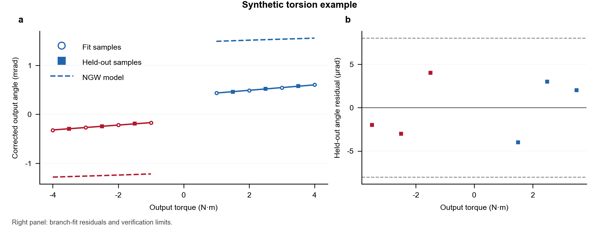

# Bidirectional static torsion calibration

[中文](torsion_calibration.md) · [English](torsion_calibration.en.md)

Fit both loaded torque–angle branches, verify them on separate runs, and optionally compare them with the joint model at the exact measured torques.

## Input data

Lock the input shaft and ring gear. Apply quasi-static pure output torque at the defined load port and record settled angular readings. Align the measured torque with the design-demand sign convention and use the same signed angular reference for both directions and data splits. Keep fixture, temperature, lubrication and loading sequence comparable. Select settled, engaged states within each loaded-flank window. Retain reversal and near-zero records separately.

Provide separate UTF-8 CSVs for fitting and verification. Keep whole runs together using `run_id` and use disjoint run IDs across files. Each flank needs at least three distinct fit torques and two distinct held-out torques within its fitted range. Observations are weighted equally. Consider reducing each settled plateau to a single observation when sampling density varies.

|Column|Meaning|
|---|---|
|`run_id`|Test-run identifier|
|`flank`|`positive` or `negative`, matching torque sign|
|`torque_n_m`|Signed nonzero output torque in N·m|
|`angle_rad`|Signed output angle in rad in the common reference|

Supply `data_kind` (`measured` or `synthetic`), `source`, `absolute_torque_window_n_m`, `fixture_compliance_rad_per_n_m`, and `verification_limit_rad` in JSON. Use independent fixture calibration and enter zero if the fixture contribution has already been removed or is negligible. Keep setup, zero reference, temperature and fixture calibration with the source record.

## Run and interpret

```bash
python -m robot_joint.torsion_cli --fit examples/torsion_calibration/fit.csv --verification examples/torsion_calibration/verification.csv --settings examples/torsion_calibration/settings.json --model examples/dfki_pin_geometry.json --output output/torsion_calibration --plots en
```

The model and plot options are optional. Install the project's `[plots]` extra for figures. Choose `--plots zh` or `--plots both` for Chinese figures with a CJK font installed.

- Subtract `C_fixture·T` from each angle and fit `θ=a+cT` separately by flank. Window-equivalent stiffness is `1/c` in N·m/rad. The signed difference between intercepts is an **extrapolated branch separation**. Physical free play requires a separate measurement. Path offsets and friction can affect the extrapolation.
- The held-out runs provide bias, RMSE and maximum absolute error. Exit code 0 indicates the branch fits meet the specified held-out error limit. Exit code 1 saves results with an exceeded limit. Exit code 2 indicates input or calculation failure.
- The optional NGW comparison recalculates sharing and both meshes at each torque. It combines gear-path twist, structural twist and signed half-backlash. A single angular zero offset comes from the fitting runs. Held-out residuals compare the unchanged model after this zero alignment. The pointwise model stiffness is the local tangent. The branch fit alone cannot identify a specific pin, carrier or mesh stiffness.

Read parameters and verification in `calibration.json`, pointwise records in `samples.csv`, and input/output SHA-256 hashes in `manifest.json`. Use branch differences to plan independent free-play or stiffness measurements, then recheck any model update on new runs.

## Synthetic worked example

The analytical data use 18000 and 20000 N·m/rad in the positive and negative directions, a shared 130 µrad zero offset, 500 µrad extrapolated branch separation and series fixture compliance of 5 µrad/(N·m). Four fit loads per flank include disturbances of about 2 µrad. Three held-out loads per flank independently add 2–4 µrad. The workflow recovers the specified stiffness and separation. Maximum held-out error is about 4.00 µrad against an 8 µrad limit. The nominal-design comparison at the same torques yields about 1008 µrad RMSE and opposite mean branch residuals of approximately −1008 and +1007 µrad.



The evidence is synthetic and numerical. Physical stiffness, free play and service hysteresis still require hardware data. See the [result](../examples/results/torsion_calibration/calibration.json) and [pointwise records](../examples/results/torsion_calibration/samples.csv).
