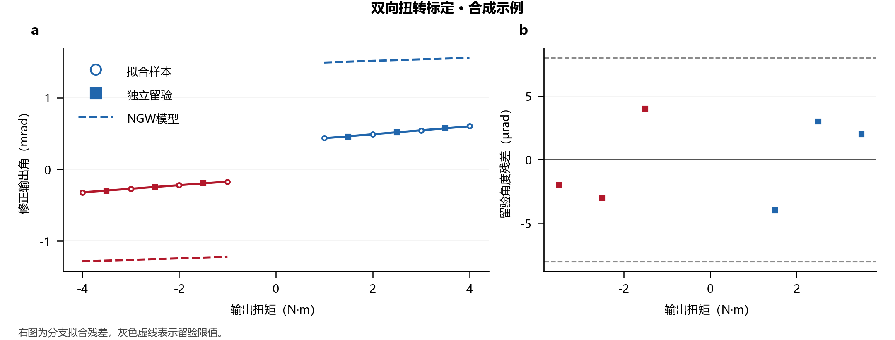

# 双向静态扭转标定

[中文](torsion_calibration.md) · [English](torsion_calibration.en.md)

将台架双向扭矩—角度记录转换为两个承载分支的等效刚度，保留独立试次误差。可在相同载荷点复算关节模型，检查模型的加载曲线和分支间隔。

## 准备数据

固定输入轴及内齿圈，在输出载荷端口施加准静态纯扭矩，记录稳定后的有符号角度。扭矩采用项目的输出需求方向，角度正方向与扭矩一致。两批试次沿用同一角度参考，保持装夹、温度、润滑和加载顺序可比。如扭矩由测力系统提供，先按作用与反作用统一符号。带载换向、过零、滑移和未稳定的点应另行保留，拟合只使用已处于对应工作面且位于指定窗口的点。

拟合和留验分别提供 UTF-8 CSV。每个试次用一个 `run_id`，以整次试验为单位分组。两个文件的试次ID必须互斥，且每侧至少有三个不同拟合扭矩和两个不同留验扭矩。留验处于该侧拟合范围内。重复采样按独立数据行等权进入计算，采样密度不均时宜先按稳定平台整理数据。

|字段|含义|
|---|---|
|`run_id`|原台架试次标识|
|`flank`|`positive`或`negative`，对应扭矩符号|
|`torque_n_m`|非零输出扭矩，N·m|
|`angle_rad`|同一参考下的有符号输出转角，rad|

设置文件中给出 `data_kind`（`measured` 或 `synthetic`）、`source`、扭矩幅值范围 `absolute_torque_window_n_m`、串联夹具柔度 `fixture_compliance_rad_per_n_m` 及留验最大绝对误差限值 `verification_limit_rad`。夹具柔度要有独立依据，已经修正的角度或可忽略的夹具柔度明确填0。建议在来源记录中注明设备、装夹、同一零点、温度及夹具标定方法。

## 运行与解释

```bash
python -m robot_joint.torsion_cli --fit examples/torsion_calibration/fit.csv --verification examples/torsion_calibration/verification.csv --settings examples/torsion_calibration/settings.json --model examples/dfki_pin_geometry.json --output output/torsion_calibration --plots en
```

`--model` 与 `--plots` 均可选。绘图安装项目的 `[plots]` 依赖。中文图使用 `--plots zh`，双版用 `--plots both`，需有中文字体。

- 按 `θ修正=θ读数−C夹具·T` 去除串联夹具转角。沿工作面分别拟合 `θ修正=a+cT`，窗口内等效刚度为 `1/c`，单位 N·m/rad。两截距之差给出有符号的零扭矩**外推分支间隔**。实际自由侧隙需另按明确定义测量，模型初始路径误差和摩擦都可能影响外推间隔。
- 留验组仅用于评价预测。报告各侧和整体的偏差、均方根误差与最大绝对误差。命令返回0表示分支拟合的留验误差在给定限值内，1表示超限并仍保存结果，2表示输入或计算失败。
- 选用模型对照时，两副齿面和系统分载逐扭矩重算，齿轮路径转角与结构转角叠加，再按工作面加减半个给定总自由侧隙。只用拟合组对齐一个共同零点，留验组保持独立。对照报告给出模型局部切线刚度和转角误差。不能用窗口平均刚度反推单个销、架板或齿面柔度。

结果包含 `calibration.json`、逐点 `samples.csv` 以及带原始输入和结果 SHA-256 的 `manifest.json`。模型与留验阈值分列，项目的结构矩阵和侧隙采用原设计值。实测后可据分支偏差安排独立侧隙测量、柔度试验或结构凝聚，再用新的独立试次复核实际改动。

## 可复算合成案例

用解析数据验证流程。正、反向预设刚度为 18000、20000 N·m/rad，共用角度零点 130 µrad，分支外推间隔 500 µrad。串联夹具柔度为 5 µrad/(N·m)。拟合组在每侧四个载荷点加入 2 µrad 量级偏差，留验组在每侧三个载荷点另加 2–4 µrad 偏差。结果恢复了预设刚度和间隔，留验最大误差约 4.00 µrad，限值为 8 µrad。同扭矩点的名义设计对照 RMSE 约 1008 µrad，正反分支平均残差约 −1008 和 +1007 µrad。该分支差异提示后续优先核查角度基准和侧隙定义。



这些数值的证据来自合成样本与项目原模型。样机刚度、实际侧隙及服役迟滞仍需实测。点级数据及误差请见[计算结果](../examples/results/torsion_calibration/calibration.json)和[逐点表](../examples/results/torsion_calibration/samples.csv)。
