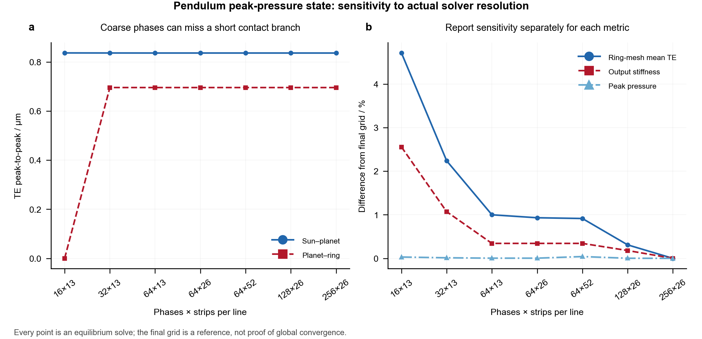

# Benchmarks, validation and confidence

[中文](validation.md) · [English](validation.en.md)

The results below are recomputed by the source code in this repository. A commercial runtime is not required. Common formula quantities, model response differences, published algorithm tables and hardware parameter consistency have separate status fields. The complete NGW assembly has no commercial assembly benchmark or physical test validation yet.

## Reproduce

```bash
python -m examples.run_benchmarks --output output/benchmarks
python -m unittest discover -s tests -v
```

Inputs, original reference arrays, identities and current results are in [benchmarks](../benchmarks/README.md). The runner verifies SHA-256 hashes and the gear kernel snapshot before passing only `case.json` to `analyze_config`. Reference TE, pressure and stiffness are never solver inputs or fitting targets. The output directory cannot replace the reference directory. Changed references, kernel files or original inputs do not automatically inherit the previous verification status.

## MASTA: the 18/77 gear pair

The reference comes from the published 18/77 example and MASTA data in a [fixed Cylindrical-Gear-LTCA commit](https://github.com/Lilililiyyy/Cylindrical-Gear-LTCA/tree/c63030dc4314a67ba282a3899f7ec8a5f6950fe1). The original component is `SMT.Gears.dll`, MASTA 15.0.179.93, with SHA-256 `afb97fbe4fa8d2274ef1ee37e061e3d052210fbb6c27e512009d7efac237470a`. This revision reuses existing numerical evidence and does not execute MASTA again. File mappings, hashes and the upstream commit are recorded in [provenance.json](../benchmarks/reference/masta_18_77/provenance.json).

The case uses 18/77 teeth, a 2 mm normal module, a 24 mm face width, a 22.5° normal pressure angle, ±23.5° helix angles and ±0.3268 profile shifts, with E=207 GPa and ν=0.3. The nominal pinion torque is 1.718873395 N·m; the LTCA torque is 2.536164808 N·m. They enter the nominal rating and loaded contact calculations separately, avoiding repeated load amplification. The selected model uses ISO combined mesh stiffness, Love strip influence and tip extension, with 32 geometric phases and 40 strips per line. Phase registration uses contact-line geometry, without adjusting phase to fit TE or pressure.

|Quantity|MASTA reference|Current kernel|Relative difference|
|---|---:|---:|---:|
|Centre distance / mm|103.591904886|103.591904886|0|
|Pinion contact stress / MPa|540.463096581|540.463096581|0|
|Pinion root stress / MPa|51.404278453|51.404278453|1.45×10⁻¹⁶|
|Mean normal TE / μm|1.106704585|1.106704539|4.14×10⁻⁸|
|Peak-to-peak TE / μm|0.03413391439|0.03413391302|4.00×10⁻⁸|
|Mean normal tangent stiffness / N/μm|220.932698401|220.932698268|6.03×10⁻¹⁰|
|Maximum endpoint pressure / MPa|186.674351800|186.674381661|1.60×10⁻⁷|

All 12 geometry/load quantities and 14 explicit-factor rating quantities meet their declared numerical criteria. Geometry quantities use an absolute tolerance of 10⁻¹⁰ in SI units plus a relative tolerance of 10⁻⁸. Rating quantities use a relative tolerance of 2×10⁻⁸; their absolute tolerances are 10⁻⁵ for Pa quantities and 10⁻⁸ otherwise. These criteria check common formula chains. They are not manufacturing or experimental accuracy specifications.

The runner also compares 32 phases and 5,040 strip centres. The maximum node-coordinate residual is 6.94×10⁻¹⁷ m. The maximum phasewise normal-TE difference is 5.28×10⁻¹² m; the maximum stiffness relative difference is 6.12×10⁻¹⁰. The maximum strip-force difference is 2.30×10⁻⁵ N, or 5.17×10⁻⁶ of the reference peak strip force. Contact-mask mismatches are zero when forces above 10⁻¹⁰ N define contact. Complete data are in [comparison.csv](../benchmarks/results/comparison.csv), [cycle.csv](../benchmarks/results/cycle.csv) and [strip_forces.csv](../benchmarks/results/strip_forces.csv).

No mechanical-model accuracy acceptance limit has been assigned to the LTCA response quantities. The small differences in the table are observations for this case. Full mathematical model equivalence is not claimed. Rating factors, material/life stress limits and boundary misalignment are explicit inputs, and this project does not reproduce their complete independent selection. Endpoint pressure and centre pressure remain separate; the main comparison uses endpoint pressure consistently. This evidence supports the reused gear-pair kernel. It does not show that three-planet load sharing, pin/housing compliance, joint hysteresis or thermal performance matches MASTA.

## MathWorks: published rainflow tables

The reference is the [official MathWorks rainflow documentation](https://www.mathworks.com/help/signal/ref/rainflow.html), accessed on 2026-11-02, page version R2026b. We use the nine-reversal example and the fourteen-reversal algorithm example. All 48 `range/mean/count` values in 16 rows match. See [reference data](../benchmarks/reference/mathworks_rainflow.json) and [comparison data](../benchmarks/results/rainflow_comparison.csv).

MATLAB was not executed in this revision. Start/end indices, the rainflow matrix and every ASTM branch are outside this comparison. Matching cycle tables does not validate S-N material parameters, gear-root stress generation or whole-joint service life.

## Physical hardware: parameter consistency

The hardware sources are the [fixed DFKI testbed description](https://github.com/dfki-ric-underactuated-lab/torque_limited_simple_pendulum/blob/11a946d4e6db58d001fdeff89be269eb61461757/hardware/testbench_description.md) and the [mjbots gearset page](https://mjbots.com/products/m05-6x-planetary-gearset), accessed on 2026-11-02. They provide real requirements and a geometry reference. They do not provide independent measurements of TE, stiffness, temperature or life for the 34 operating states used here.

|Consistency check|Derived/current value|Published value|Interpretation|
|---|---:|---:|---|
|Total mass / kg|0.546+0.130=0.676|0.676|Parameter consistency|
|Uniform-rod-model COM / m|0.451923077|approximately 0.45|1.923 mm or 0.427% difference from an approximate value|
|Fixed-ring ratio|1+100/20=6|6|Kinematic consistency|
|Kt×rated current / N·m|0.091×12=1.092|1.092|Consistent under the same current convention|
|Kt×peak current / N·m|0.091×24=2.184|2.184|Consistent under the same current convention|
|Sun–planet centre distance / mm|0.5(20+40)/2=15|30|Unresolved source discrepancy; no pass claim|

The model uses the standard zero-shift centre distance of 15 mm. The supplier's 30 mm statement still needs clarification. Product output torque also depends on transmission efficiency, current control and thermal limits, so ideal `iKtI` is not treated as a measured actuator torque calibration. Data are in [hardware_parameters.csv](../benchmarks/results/hardware_parameters.csv).

## Coverage and next steps

|Level|Current evidence|Remaining gap|
|---|---|---|
|Gear-pair geometry and explicit rating|12+14 scalar quantities meet numerical criteria|Complete rating-factor selection and material/life chain|
|Gear-pair LTCA|32 phases, 5,040 strips and reported response differences|Full 3D gear/housing compliance and engineering accuracy limits|
|Rainflow counting|Two published tables; 48 exact scalar matches|Fatigue experiments and material calibration|
|Physical requirements|Four consistent quantities; approximate COM difference reported separately|Measured loaded TE, stiffness and temperatures|
|NGW system|Equations, residuals, analytical and regression checks|Commercial assembly and physical tests under matched boundaries|

The first priority is a three-planet assembly benchmark with matched tooth counts, pin/ring/housing boundaries and errors, retaining each planet reaction, loaded angle and output stiffness. Reversing torque–angle tests should then separate elasticity, backlash and friction. Loss/thermal identification and oscillating-bearing validation are also needed. No independent KISSsoft, JYCD or ETAGear results are currently available for this assembly; their inclusion in the original architecture discussion does not imply a passed benchmark.


## NGW case discretization sensitivity

Seven resolutions independently solve the baseline duty's peak-pressure state `reverse_04`, keeping geometry, load, errors and compliance fixed. Phase refinement precedes strip comparisons. Differences below use 256×26 as this study's reference, not an exact solution.

|Phases×strips|Peak pressure / MPa|Ring-mesh TE peak-to-peak / μm|Ring-mesh mean TE difference / %|Output stiffness difference / %|
|---|---:|---:|---:|---:|
|16×13|827.427|0.00000|4.714|2.556|
|32×13|827.282|0.69604|2.238|1.070|
|64×13|827.211|0.69593|1.000|0.343|
|64×26|827.211|0.69593|0.932|0.343|
|64×52|827.516|0.69593|0.915|0.343|
|128×26|827.194|0.69591|0.309|0.180|
|256×26|827.176|0.69588|0.000|0.000|



The original 16 phases missed the ring mesh's short contact branch and reported zero TE peak-to-peak; similar peak pressure is insufficient to establish TE or stiffness resolution. The full case now uses 64×26, with ring-mesh mean TE and stiffness differences of 0.932% and 0.343% from the final reference. Changing 64×26 to 64×52 changes peak pressure by about 0.037%, without resolving every misaligned, low-load or edge-contact condition. Every coupled solve satisfies its declared iteration tolerances. This study proves neither all-state nor asymptotic convergence.

Run `python -m examples.check_joint_resolution --output output/benchmarks/resolution`, then `python -m examples.plot_validation --source output/benchmarks --output output/benchmarks`. Source tables: [resolution.json](../benchmarks/results/resolution/resolution.json) and [resolution.csv](../benchmarks/results/resolution/resolution.csv).
