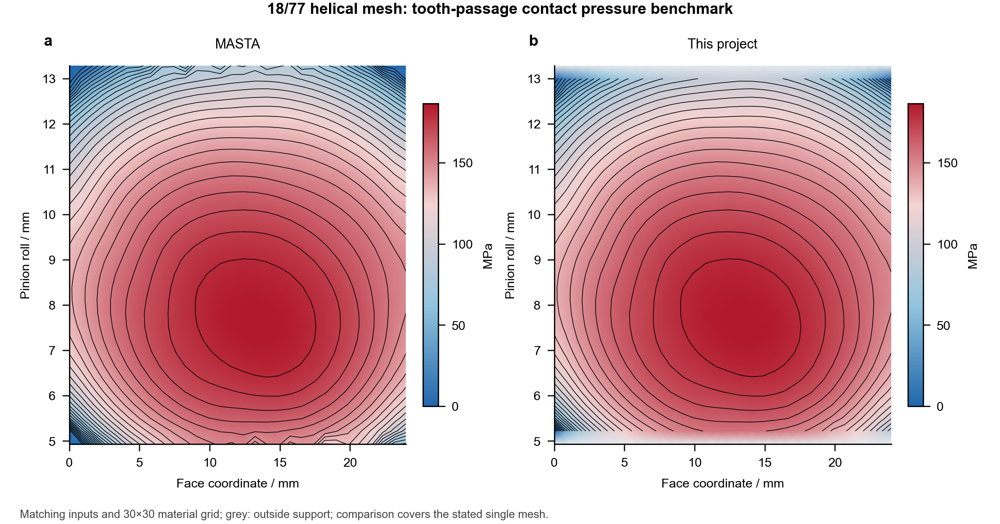

# Result benchmarks

[中文](validation.md) · [English](validation.en.md)

This project calculates responses from independent inputs and compares them with saved MASTA numerical results. Reference responses are used only for comparison, never as solver inputs.

## 18/77 helical mesh

The case uses 18/77 teeth, 2 mm normal module, 24 mm face width, 22.5° normal pressure angle, ±23.5° helix angles and ±0.3268 profile shifts, with E=207 GPa and ν=0.3. Nominal pinion torque is 1.718873395 N·m and loaded-contact torque is 2.536164808 N·m. Strength uses explicit rating factors; contact uses ISO aggregate stiffness, Love strip influence and tip extension.

|Metric|MASTA reference|This project|
|---|---:|---:|
|Centre distance / mm|103.591904886|103.591904886|
|Pinion contact stress / MPa|540.463096581|540.463096581|
|Pinion root stress / MPa|51.404278453|51.404278453|
|Mean normal TE / μm|1.106704585|1.106704539|
|TE peak-to-peak / μm|0.03413391439|0.03413391302|
|Mean normal tangent stiffness / N/μm|220.932698401|220.932698268|
|Peak endpoint pressure / MPa|186.674351800|186.674381661|


## Tooth-passage contact pressure



Ordinary-flank passage peak pressures are compared on the same 30×30 face/material-roll grid. Endpoint pressures and interpolated display pressures remain distinct quantities.

|Metric|Result|
|---|---:|
|Common finite display points|840|
|Project display points outside support|60|
|Mean absolute difference / MPa|0.040641|
|Root mean square difference / MPa|0.140090|
|Maximum absolute difference / MPa|2.994763|
|MASTA / project display peak / MPa|186.522329 / 186.524300|

## Benchmark scope

The reference consists of saved MASTA 15.0.179.93 single-mesh results. Pressure, load, phase and material coordinates use matching definitions. Unsupported display regions are not filled with zero. MASTA was not rerun for this comparison.

Results cover the stated geometry, material, load, modifications and boundaries. They do not validate a three-planet assembly, temperature, control precision or hardware service life. Rating factors, allowable stresses and material-life data remain explicit inputs.

## Calculation and data

```bash
python -m examples.run_benchmarks --output output/benchmarks
python -m examples.benchmark_contact --output output/contact_benchmark
```

See [benchmarks](../benchmarks/README.md) for inputs and numerical results. Geometry, strength, TE, stiffness and pressure are reported separately; agreement in one metric is not extended to all engineering performance.
