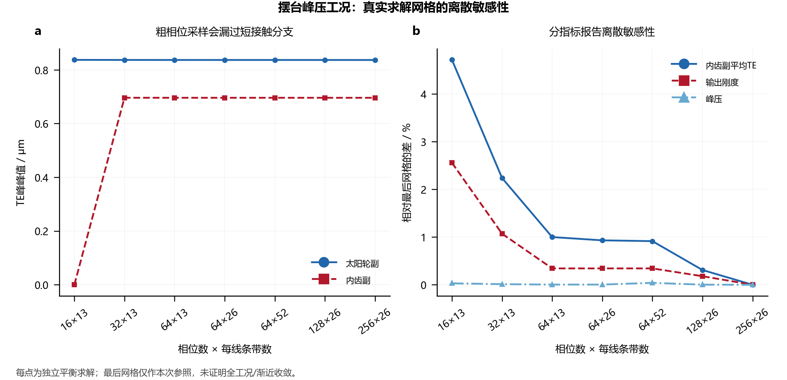

# 对标、验证与可信度

[中文](validation.md) · [English](validation.en.md)

当前结果由本仓库源码重新求得；商业软件运行时不是依赖。验证分为共同公式量、模型响应差异、公开算法表和硬件参数一致性，分别报告状态。NGW总成目前没有商业软件整体对标或物理试验。

## 复算

```bash
python -m examples.run_benchmarks --output output/benchmarks
python -m unittest discover -s tests -v
```

公开输入、原参考数组、文件身份与本次结果见[benchmarks](../benchmarks/README.md)。脚本先验证SHA-256及内核快照，再只用`case.json`调用`analyze_config`；参考TE、压力和刚度不用于拟合或求解。结果目录不能覆盖参照目录。修改参照、内核或原输入后不能自动继承原通过状态。

## MASTA：18/77单副齿轮

来源为[Cylindrical-Gear-LTCA固定提交](https://github.com/Lilililiyyy/Cylindrical-Gear-LTCA/tree/c63030dc4314a67ba282a3899f7ec8a5f6950fe1)中已公开的18/77案例与MASTA参考数据。原组件为MASTA 15.0.179.93的`SMT.Gears.dll`，SHA-256为`afb97fbe4fa8d2274ef1ee37e061e3d052210fbb6c27e512009d7efac237470a`。本轮复用既有数值证据，没有再次执行MASTA；具体文件映射、哈希及上游提交见[provenance.json](../benchmarks/reference/masta_18_77/provenance.json)。

案例采用18/77齿、2 mm法向模数、24 mm齿宽、22.5°法向压力角、±23.5°螺旋角和±0.3268变位，材料E=207 GPa、ν=0.3。名义小轮扭矩1.718873395 N·m，LTCA扭矩2.536164808 N·m。两者分别进入名义强度和承载接触链，不能重复放大。使用ISO综合刚度、Love条带影响、齿顶延伸，32个几何相位、每线40个条带；相位来自接触线几何配准，没有按TE或压力响应调整。

|量|MASTA参考|当前内核|相对差|
|---|---:|---:|---:|
|中心距 / mm|103.591904886|103.591904886|0|
|小轮接触应力 / MPa|540.463096581|540.463096581|0|
|小轮齿根应力 / MPa|51.404278453|51.404278453|1.45×10⁻¹⁶|
|平均法向TE / μm|1.106704585|1.106704539|4.14×10⁻⁸|
|TE峰峰值 / μm|0.03413391439|0.03413391302|4.00×10⁻⁸|
|平均法向切线刚度 / N/μm|220.932698401|220.932698268|6.03×10⁻¹⁰|
|最大端点压力 / MPa|186.674351800|186.674381661|1.60×10⁻⁷|

12个几何/载荷量和14个显式因子强度量满足逐字段数值判据。几何量采用绝对容差10⁻¹⁰ SI加相对容差10⁻⁸；强度标量采用相对容差2×10⁻⁸，Pa量绝对容差10⁻⁵，其余10⁻⁸。判据是共同公式链的数值核验，不是产品制造或试验精度。

另外保留32个相位和5040个中心节点的比较：节点坐标最大差6.94×10⁻¹⁷ m；法向TE逐相位最大绝对差5.28×10⁻¹² m；刚度最大相对差6.12×10⁻¹⁰；条带力最大绝对差2.30×10⁻⁵ N，相当于参考最大条带力的5.17×10⁻⁶。以10⁻¹⁰ N为承载判定阈值时，接触开闭差异为0。完整结果见[comparison.csv](../benchmarks/results/comparison.csv)、[cycle.csv](../benchmarks/results/cycle.csv)与[strip_forces.csv](../benchmarks/results/strip_forces.csv)。

LTCA标量没有设置机械模型精度验收界限，表中的小数值差异只属于本工况的观测结果。双方完整数学模型等效性未被宣称；评级因子、材料寿命应力限和边界失准是显式输入，本项目没有独立复现完整因子选取。端点压力与中心压力也分别定义，主表统一使用端点压力。该项支持所复用的单副计算内核，不能证明三行星分载、销/箱体柔度、关节迟滞或热性能与MASTA一致。

## MathWorks：雨流公开表

参照[MathWorks官方rainflow文档](https://www.mathworks.com/help/signal/ref/rainflow.html)，访问日期2026-11-02、页面版本R2026b。选用9个转折点的已知采样率示例，以及14个转折点的算法说明示例。当前新写雨流实现与公开表的16行`range/mean/count`共48个标量完全一致。参照数值见[mathworks_rainflow.json](../benchmarks/reference/mathworks_rainflow.json)，输出见[rainflow_comparison.csv](../benchmarks/results/rainflow_comparison.csv)。

本轮未运行MATLAB，不核验起止样本索引、雨流矩阵或所有ASTM分支。这项结果验证循环计数示例，不能验证S-N材料参数、齿根应力生成或整机服役寿命。

## 公开实物：参数一致性

硬件来源为[DFKI实物摆台固定提交](https://github.com/dfki-ric-underactuated-lab/torque_limited_simple_pendulum/blob/11a946d4e6db58d001fdeff89be269eb61461757/hardware/testbench_description.md)与[mjbots齿轮组页面](https://mjbots.com/products/m05-6x-planetary-gearset)，访问日期2026-11-02。它们提供真实硬件需求和几何参照，没有提供本模型34工况的独立TE、刚度、温升或寿命测试结果。

|一致性检查|推导/当前值|公开值|解读|
|---|---:|---:|---|
|总质量 / kg|0.546+0.130=0.676|0.676|参数一致|
|均匀细杆模型COM / m|0.451923077|约0.45|差1.923 mm、0.427%；原公开值为近似值|
|固定环速比|1+100/20=6|6|运动学一致|
|Kt×额定电流 / N·m|0.091×12=1.092|1.092|同一电流基准下参数一致|
|Kt×峰值电流 / N·m|0.091×24=2.184|2.184|同一电流基准下参数一致|
|太阳—行星中心距 / mm|0.5(20+40)/2=15|30|来源冲突保留，未作误差通过|

中心距采用零变位标准关系的15 mm；供应页的30 mm表述仍须供应方澄清。输出电机转矩经过效率、控制电流和热限制后才能与产品额定输出比较，因此这里不把理想`iKtI`当作样机转矩标定。数据见[hardware_parameters.csv](../benchmarks/results/hardware_parameters.csv)。

## 覆盖状态与下一步

|层级|当前证据|尚未覆盖|
|---|---|---|
|单副几何与显式强度|12+14标量数值通过|完整标准因子自动选取、材料寿命链|
|单副LTCA|32相位、5040条带及标量差异|全三维轮体/箱体、工程精度界限|
|雨流计数|2组公开表、48标量完全一致|完整疲劳试验与材料标定|
|实物需求|4项参数一致、近似COM差单列|样机受载TE/刚度/温升实测|
|NGW系统|方程、残差、解析与回归测试|相同总成边界的商业软件和试验对标|

优先补充相同齿数、销/环/箱体边界及误差分布的三行星总成对标，保留各行星反力、承载角和输出刚度；随后用正反向扭矩—角度试验区分弹性、侧隙及摩擦，开展温升/损耗辨识和摆动轴承验证。KISSsoft、精益传动和ETAGear目前没有可直接用于本总成的独立数值参照，不能因最初架构讨论包含这些软件而把对标状态标为通过。


## NGW案例的离散敏感性

以基准完整任务中的峰压代表工况`reverse_04`固定几何、载荷、误差和柔度，独立求解7组离散；先加密相位，再比较条带。下表的差异以256×26为本次参照，不称其为精确解。

|相位×条带|峰压 / MPa|内齿副TE峰峰值 / μm|内齿副平均TE差 / %|输出刚度差 / %|
|---|---:|---:|---:|---:|
|16×13|827.427|0.00000|4.714|2.556|
|32×13|827.282|0.69604|2.238|1.070|
|64×13|827.211|0.69593|1.000|0.343|
|64×26|827.211|0.69593|0.932|0.343|
|64×52|827.516|0.69593|0.915|0.343|
|128×26|827.194|0.69591|0.309|0.180|
|256×26|827.176|0.69588|0.000|0.000|



原16相位遗漏内齿副短接触分支，TE峰峰值为零；峰压相近不能代替TE和刚度检查。完整案例改用64×26，相对最终参照的内齿副平均TE差0.932%、刚度差0.343%。64×26至64×52的峰压差约0.037%，不代表所有失准、低载或边缘接触都已解析。每项耦合均满足声明的迭代容差；本研究未证明全工况或渐近收敛。

复算`python -m examples.check_joint_resolution --output output/benchmarks/resolution`；随后运行`python -m examples.plot_validation --source output/benchmarks --output output/benchmarks`。原始表见[resolution.json](../benchmarks/results/resolution/resolution.json)和[resolution.csv](../benchmarks/results/resolution/resolution.csv)。
