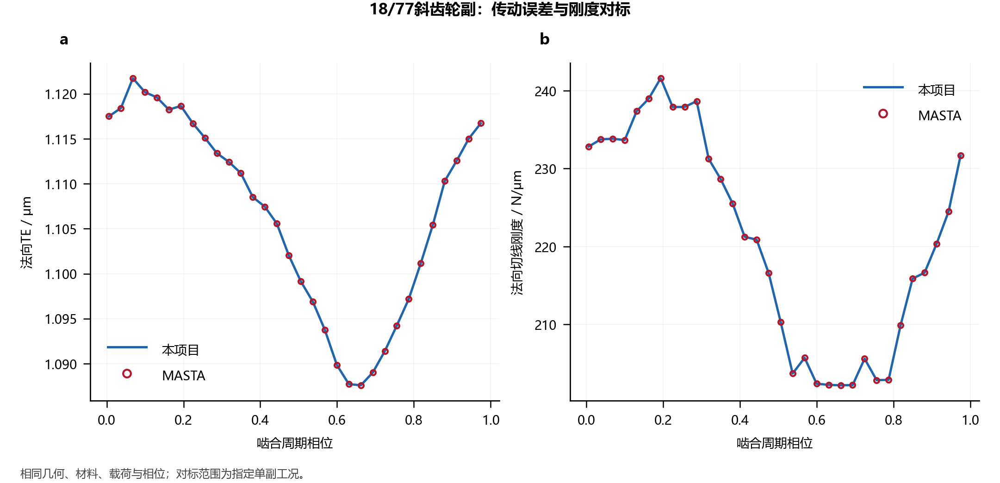
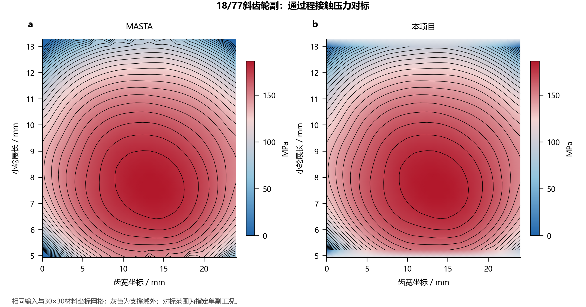

# 结果对标

[中文](validation.md) · [English](validation.en.md)

本项目以独立输入计算结果，并与已保存的MASTA数值参照比较。参考响应只用于结果比较，不作为求解输入。

## 18/77斜齿轮副

采用18/77齿、2 mm法向模数、24 mm齿宽、22.5°法向压力角、±23.5°螺旋角和±0.3268变位，材料E=207 GPa、ν=0.3。名义小轮扭矩1.718873395 N·m，承载接触扭矩2.536164808 N·m。强度采用显式评级因子，接触计算采用ISO综合刚度、Love条带影响及齿顶延伸。

|指标|MASTA参考|本项目|
|---|---:|---:|
|中心距 / mm|103.591904886|103.591904886|
|小轮接触应力 / MPa|540.463096581|540.463096581|
|小轮齿根应力 / MPa|51.404278453|51.404278453|
|平均法向TE / μm|1.106704585|1.106704539|
|TE峰峰值 / μm|0.03413391439|0.03413391302|
|平均法向切线刚度 / N/μm|220.932698401|220.932698268|
|最大端点压力 / MPa|186.674351800|186.674381661|



## 通过程接触压力



双方在相同30×30齿宽—材料展长网格上比较普通齿廓的通过程峰压。端点压力与显示插值压力分别定义。

|指标|结果|
|---|---:|
|共同有效显示点|840|
|本项目支撑域外显示点|60|
|平均绝对差 / MPa|0.040641|
|均方根差 / MPa|0.140090|
|最大绝对差 / MPa|2.994763|
|MASTA / 本项目显示峰压 / MPa|186.522329 / 186.524300|

## 对标范围

参照为已保存的MASTA 15.0.179.93单副结果。压力、载荷、相位及材料坐标采用相同定义；未覆盖的显示区域不填零。本次未重新运行MASTA。

结果支持所列几何、材料、载荷、修形和边界下的单副比较，不作为三行星总成、温升、控制精度或样机寿命的验证。评级因子、许用应力及材料寿命数据仍为显式输入。

## 计算与数据

```bash
python -m examples.run_benchmarks --output output/benchmarks
python -m examples.benchmark_contact --output output/contact_benchmark
```

对标输入、结果和数据说明见[benchmarks](../benchmarks/README.md)。几何、强度、TE、刚度和压力分别报告，不将一个指标的接近扩展为全部工程性能。
